<h1 align="center">
  <picture>
    <source media="(prefers-color-scheme: dark)" srcset="docs/images/banner-dark.png">
    <source media="(prefers-color-scheme: light)" srcset="docs/images/banner-light.png">
    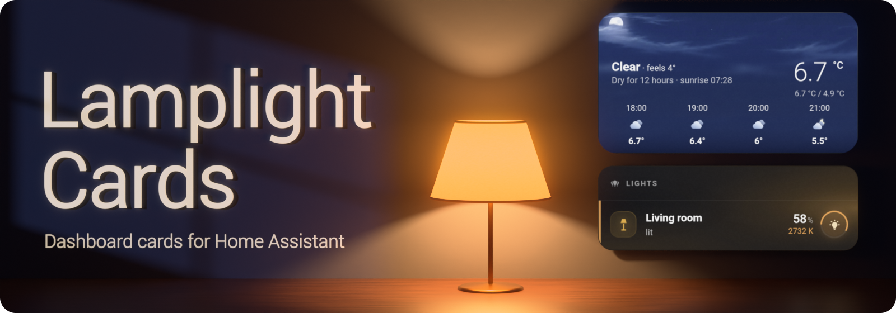
  </picture>
</h1>

This project grew out of a desire to build one card to represent the lights, temperature and humidity in a room. 
It became the rooms card which had a distinct aesthetic. I wanted to build out more of it to 
see where it would go.

So now there are far more cards.

I built them to meet the needs of my dashboard. How I use the cards is going to reflect some of my quirks:

 - The cards are sized to fit on a phone.
 - Decoration encodes state.
 - It is colorful. You can make it less colorful if you want.
 - The cards are built around the devices I use.
 - There is an optional cover that can be placed over a light's brightness slider so that I don't accidentally 
   change it while scrolling. I know there are other ways to do this. Yes, I was having fun. I told you 
   it was quirky. It's _optional_.

The cards are shared here in case you find them useful. 
 
#### So what are they?

Most of the panels have a dark background and one accent color with light coming in from the right
edge. On the rooms card and the light panels, that light moves towards whatever is switched on,
and it gets a bit stronger as you turn on more. On the rooms card the whole card gets lighter too, even over on the
left, so a house with every light on really does look warmer than one with a single lamp.

<p align="center">
  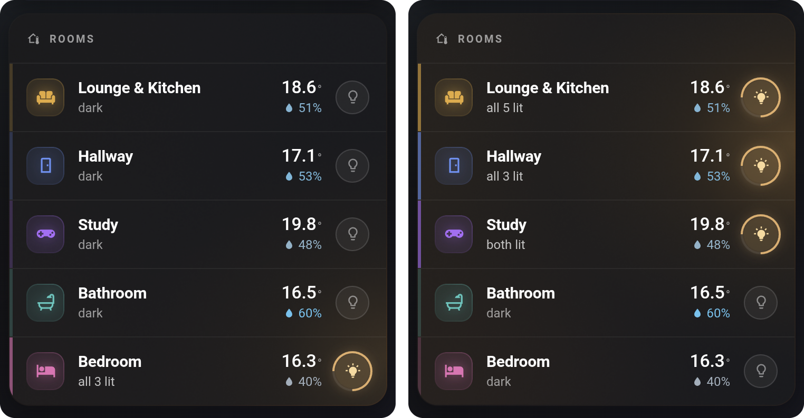
</p>

On panels that show information, like climate, windows and waste, the light stays where it is. The
weather card does its own thing and the house scenes glow on their own.

<p align="center">
  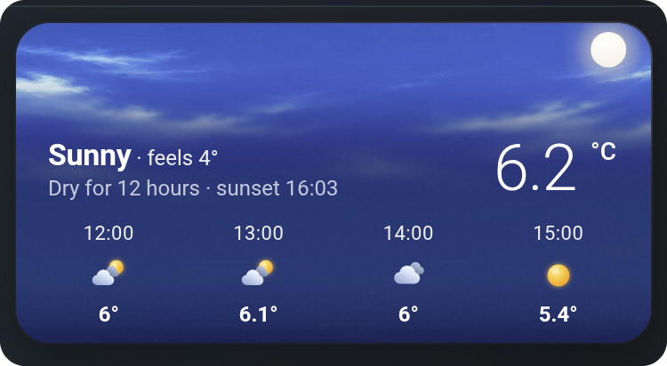
  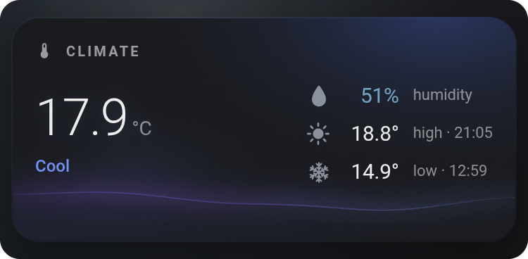
  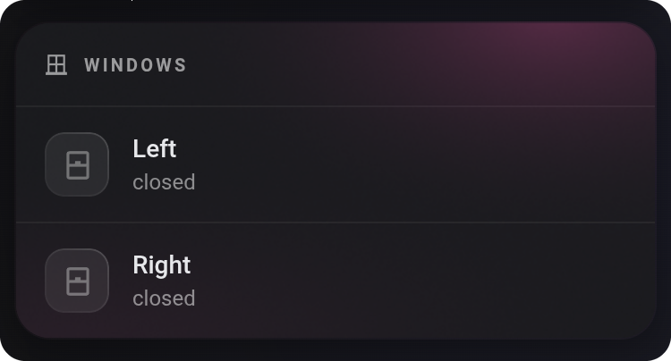
  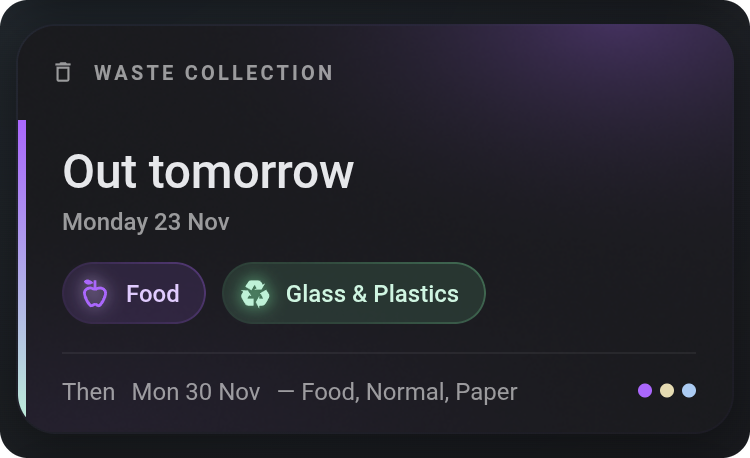
</p>

Here is how it all looks together:

<p align="center">
  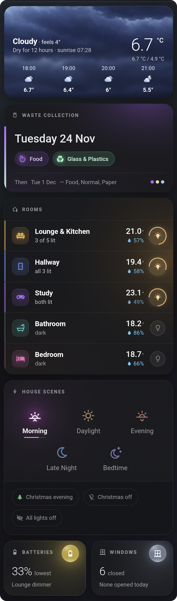
</p>

> [!NOTE]
> Lamplight is still in development. There is no
> visual editor so everything is set up in YAML. Don't let that put you off. Every page in
> these docs has an example that you can copy and paste.

## Highlights

### The light cards have a glow to them

Turning on a light causes the panel's light to drift towards that row. Turn on three and the whole panel
warms up. You can see which lights are lit before you scan the text. 

<p align="center">
  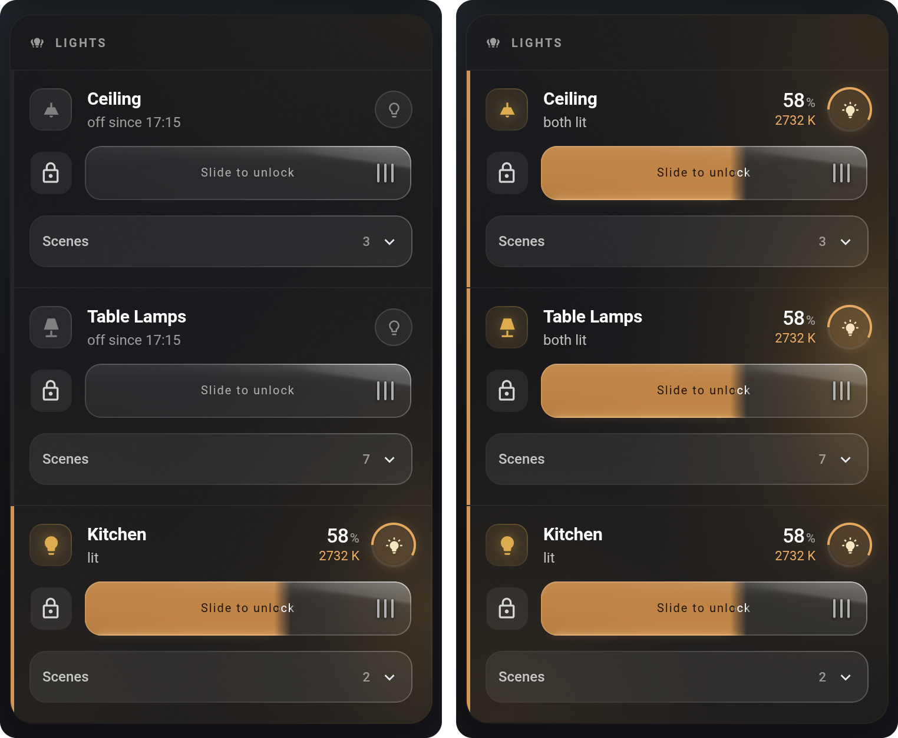
</p>

You can give each room its own accent color and the glow picks it up, so no two rooms feel quite the
same. Each room gets its own panels too. In this picture the lounge has an air purifier, the study puts
its smart plugs at the top, and the bedroom shows its windows. The hallway just has its lights.

<p align="center">
  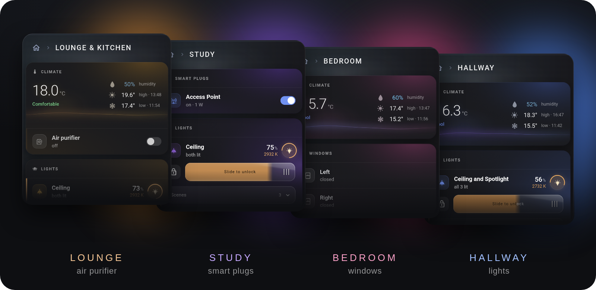
</p>

### Unified look and feel

Most of the cards use the same dark panel so they match even though their light behaves differently.
You choose a color for each panel from a list of names (`marigold`, `lagoon`, `rose` and [so on](docs/styling.md)). 
It saves you from messing with RGB values.

If there is a standard Home Assistant card that you'd like to use, put it in a Lamplight panel. It
will pick up the same colors (though it might need some additional styling).

### Custom weather card with its own popup

This is often the first card people notice. The sky is painted, and it follows both the weather and
the sun. It's bright blue at midday and turns a warm gold as the sun goes down. Rain brings grey
streaks, and a clear night has stars. The moon comes out after dark in its real phase for that night,
and slips behind the clouds if there are any. On a hot day the sun burns amber. In a thunderstorm the
clouds turn purple. The sky blends from one light to the next during the day, so you won't see it
jump between pictures.

<p align="center">
  
  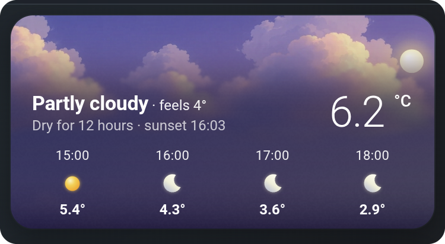
  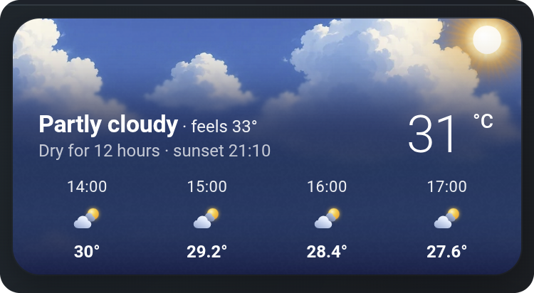
  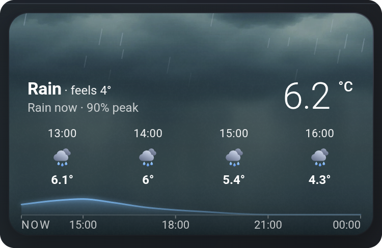
  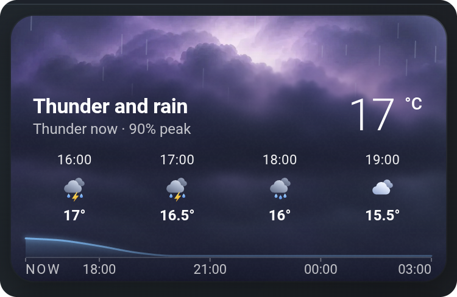
  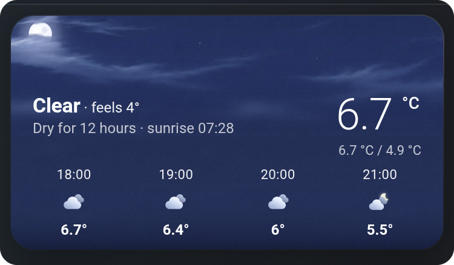
</p>

Below the sky are the next few hours and a one-line summary of the weather. If rain looks likely
there is a rain chart at the bottom. Weather warnings are shown too.

Tap the card and the Today popup slides up. It has the whole day in it: the high and low, sunrise and
sunset, a sentence about how the day will go, and a single timeline of what's coming. When rain is on
the way you can see when it starts, how heavy it gets and when it clears. Note that the tap needs one
extra step to set up, which is on the
[weather page](docs/cards/weather.md#open-the-today-popup-with-a-tap).

<p align="center">
  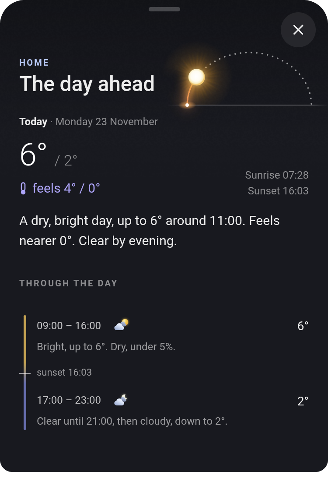
</p>

### The same sky persists through the dashboard

The weather isn't limited to the weather card. Some of the other cards use it too.

The same moon, in the same phase, is on the arc in the Today popup and in the windows popups. The
phase is worked out from the date so you don't need another sensor for it.

Open the windows popup for a room and you are looking out at that same sky, with the weather and time
of day as they are right now. On a clear day it's blue, with the sun in the window and its light
spilling onto the floor. Cloud or fog makes everything soft and grey. If the night is clear, you get
the moon and a paler light instead.

<p align="center">
  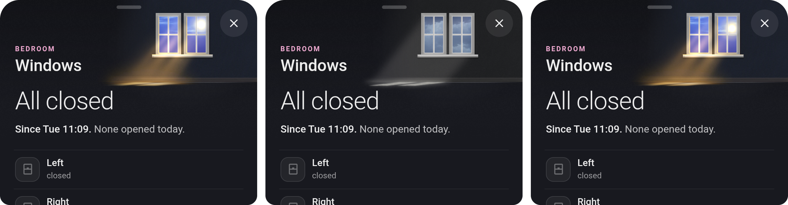
</p>

The smaller details use weather data as well. In the climate popup, the outside temperature for the
last 24 hours is drawn on the same graph as the room's temperature so that you can see how the two compare. 
It reads the temperature sensor from your weather integration. The windows popups look ahead instead, and 
check the forecast for rain, snow or cold in the next few hours.

### Popups for smart plugs, climate and window sensors

Tap a panel and a sheet slides up with the details. The picture at the top shows you what it's about.
A smart plug glows while it's drawing power and a battery is filled to its level. For climate, it's a
frost crystal when the room is cold and a sun when it's warm.

The window popups are a highlight. The light in them is the real light outside. Sunlight comes in at
the sun's actual height and softens under cloud. At night you get moonlight. And if a window is open
with rain or cold on the way, the popup says so.

<p align="center">
  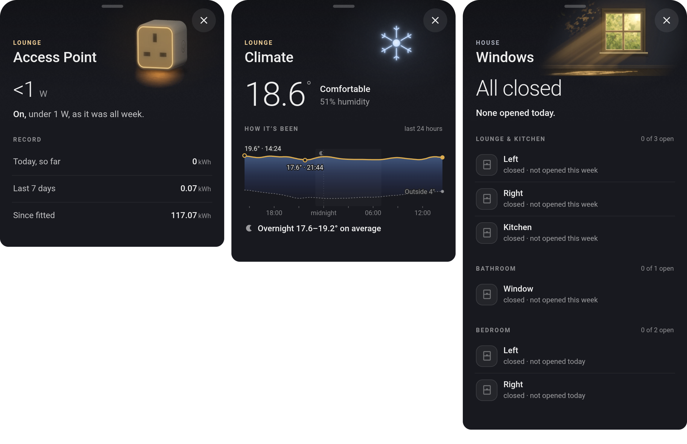
</p>

### See the important things only when needed

Most of the time Lamplight keeps quiet. When something needs your attention, the card that knows about
it will tell you in plain words. Once you have sorted it out, the note goes away.

Weather warnings get the most room. On the weather card, a warning is shown in the color of its level,
along with when it starts or ends. The Today popup puts it right at the top and marks the hours it
covers on the timeline.

<p align="center">
  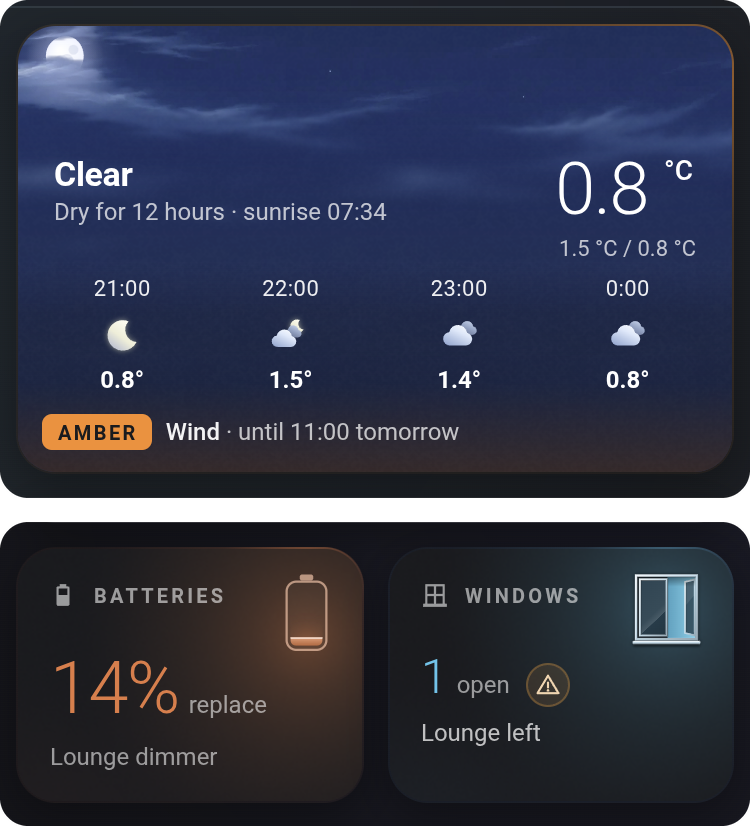
</p>

<p align="center">
  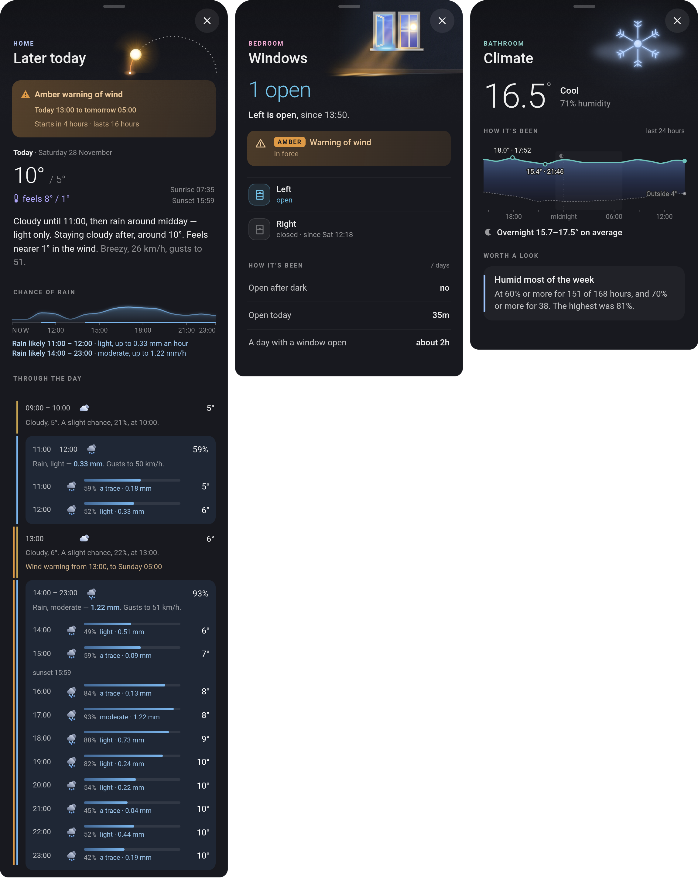
</p>

There are some smaller nudges too:

- If you leave a window open while a warning, rain, snow or cold is on the way, the windows popup lets
  you know. The small windows panel gets a mark as well. In fact, an open window shows up on
  [five cards at once](docs/cards/windows.md#one-open-window-everywhere-it-matters).
- The batteries panel turns orange when a battery runs low and tells you which one to replace. You'll
  also find it under Replace soon in the batteries popup.
- The climate popup only adds a "Worth a look" note when there is something to see. That could be a room
  that's been humid for most of the week, or one that's much colder or warmer than the week before.

On a quiet day you won't see any of these.

### A batteries card and popup that can find its entities

Add the batteries card and it will find every battery in your home by itself. They are sorted into
"replace soon", "worth noticing" and "fine", so you know which one to change next. You don't have a
list to keep up to date.

<p align="center">
  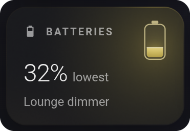<br>
  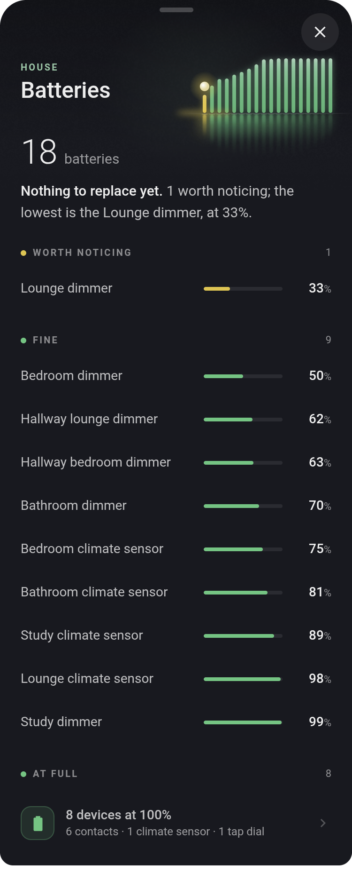
</p>

### No other dashboard plugins needed but they do enhance some features

Lamplight works without any other plugins. If you already use
[Bubble Card](https://github.com/Clooos/Bubble-Card) or
[mini-graph-card](https://github.com/kalkih/mini-graph-card), it can make use of them. Bubble Card gives
each light a brightness slider, and mini-graph-card adds graphs to the popups. Without them every card
still works and still looks finished.

## The cards

There are 22 cards in 14 groups. Each group has its own page, and tapping a picture will take you there.

<table>
  <tr>
    <td align="center" valign="top" width="33%">
      <a href="docs/cards/weather.md"></a><br>
      <b><a href="docs/cards/weather.md">Weather</a></b><br>
      <sub>The painted sky and forecast, and the Today popup</sub><br>
      <sub><code>lamplight-weather</code> <code>lamplight-day</code></sub>
    </td>
    <td align="center" valign="top" width="33%">
      <a href="docs/cards/climate.md">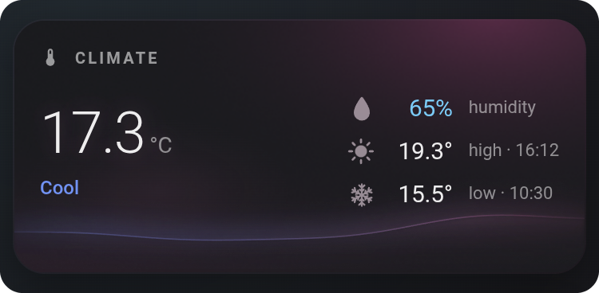</a><br>
      <b><a href="docs/cards/climate.md">Climate</a></b><br>
      <sub>Temperature, humidity and comfort, with a popup that explains them</sub><br>
      <sub><code>lamplight-climate</code> <code>lamplight-climate-detail</code></sub>
    </td>
    <td align="center" valign="top" width="33%">
      <a href="docs/cards/lights.md">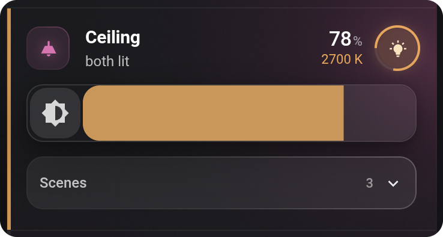</a><br>
      <b><a href="docs/cards/lights.md">Lights</a></b><br>
      <sub>A light with its brightness and color, and a list of scenes</sub><br>
      <sub><code>lamplight-light</code> <code>lamplight-scenes</code></sub>
    </td>
  </tr>
  <tr>
    <td align="center" valign="top" width="33%">
      <a href="docs/cards/rooms.md">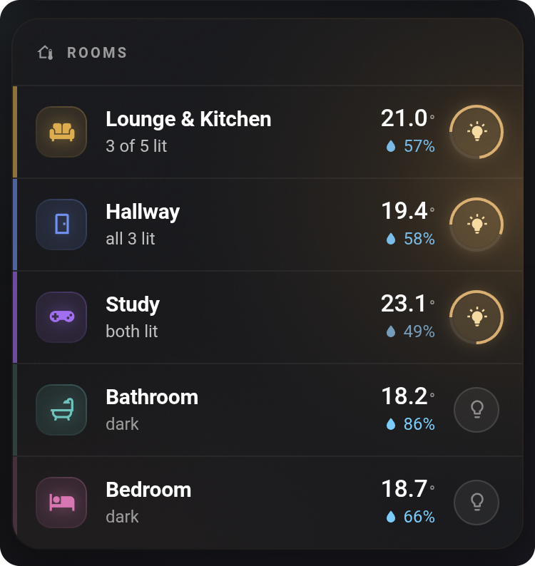</a><br>
      <b><a href="docs/cards/rooms.md">Rooms</a></b><br>
      <sub>Every room at a glance: lights, temperature, humidity, open windows</sub><br>
      <sub><code>lamplight-rooms</code></sub>
    </td>
    <td align="center" valign="top" width="33%">
      <a href="docs/cards/rows.md">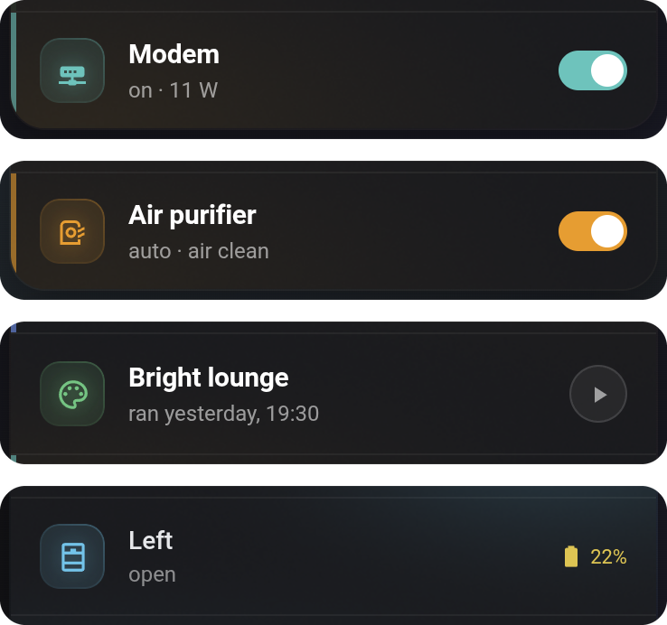</a><br>
      <b><a href="docs/cards/rows.md">Rows</a></b><br>
      <sub>A simple row for a plug, a fan, a script or a window sensor</sub><br>
      <sub><code>lamplight-row</code></sub>
    </td>
    <td align="center" valign="top" width="33%">
      <a href="docs/cards/panel.md"></a><br>
      <b><a href="docs/cards/panel.md">The panel</a></b><br>
      <sub>The glowing panel that holds your other cards</sub><br>
      <sub><code>lamplight-panel</code> <code>lamplight-strips</code> <code>lamplight-spacer</code></sub>
    </td>
  </tr>
  <tr>
    <td align="center" valign="top" width="33%">
      <a href="docs/cards/room-header.md">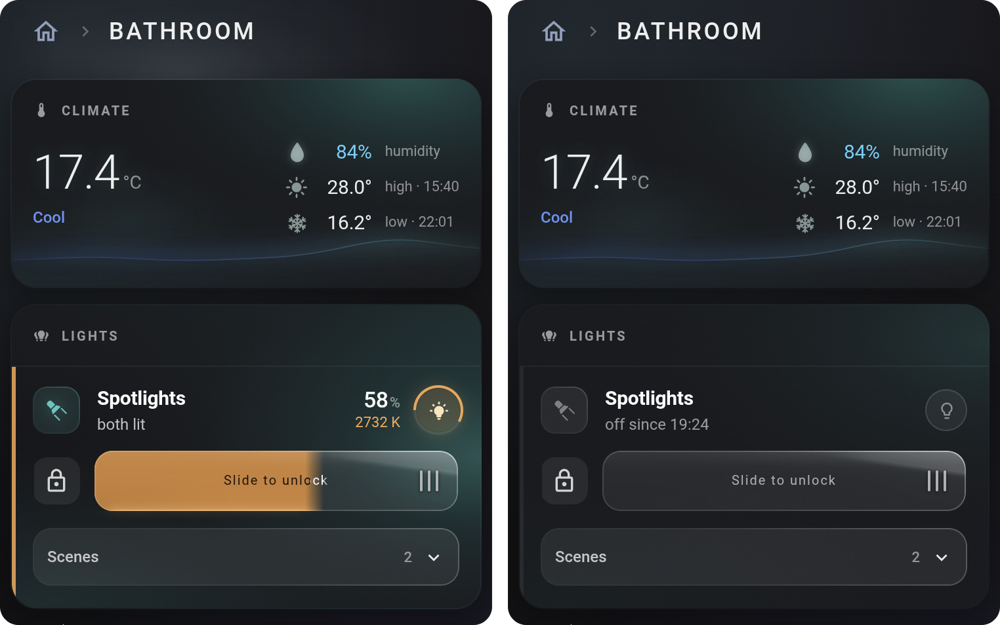</a><br>
      <b><a href="docs/cards/room-header.md">Room header</a></b><br>
      <sub>The top of a room's page, with a glow when a lamp is on</sub><br>
      <sub><code>lamplight-header</code></sub>
    </td>
    <td align="center" valign="top" width="33%">
      <a href="docs/cards/waste.md"></a><br>
      <b><a href="docs/cards/waste.md">Waste</a></b><br>
      <sub>Which bin goes out next, and when</sub><br>
      <sub><code>lamplight-waste</code></sub>
    </td>
    <td align="center" valign="top" width="33%">
      <a href="docs/cards/popups.md"></a><br>
      <b><a href="docs/cards/popups.md">Popups</a></b><br>
      <sub>The sliding sheet itself, and the popup for air purifiers</sub><br>
      <sub><code>lamplight-popup</code> <code>lamplight-purifier-detail</code></sub>
    </td>
  </tr>
  <tr>
    <td align="center" valign="top" width="33%">
      <a href="docs/cards/house-scenes.md">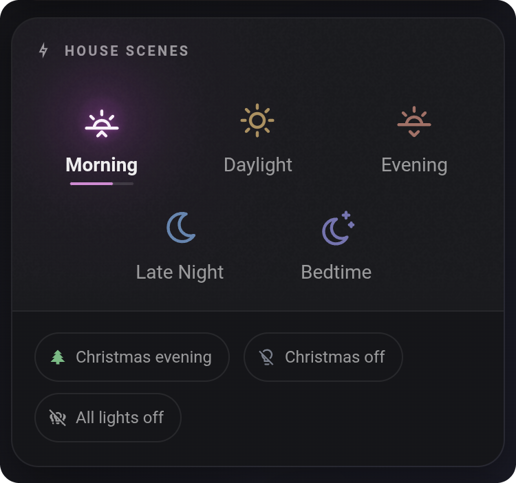</a><br>
      <b><a href="docs/cards/house-scenes.md">House scenes</a></b><br>
      <sub>Your scenes and routines as a row of lamps</sub><br>
      <sub><code>lamplight-routines</code></sub>
    </td>
    <td align="center" valign="top" width="33%">
      <a href="docs/cards/smart-plugs.md">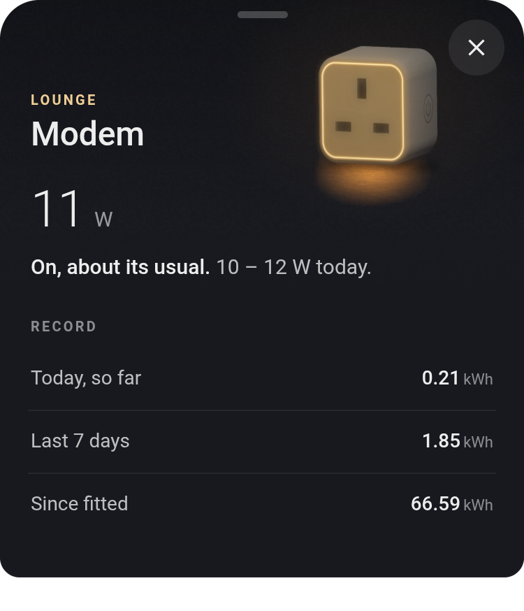</a><br>
      <b><a href="docs/cards/smart-plugs.md">Smart plugs</a></b><br>
      <sub>The power now, whether that's usual, and the energy record</sub><br>
      <sub><code>lamplight-plug-detail</code></sub>
    </td>
    <td align="center" valign="top" width="33%">
      <a href="docs/cards/chips.md">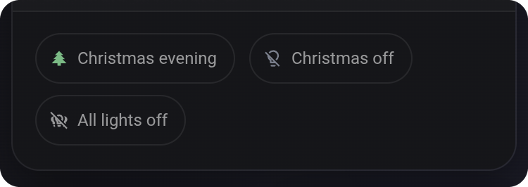</a><br>
      <b><a href="docs/cards/chips.md">Chips</a></b><br>
      <sub>A row of small buttons for the things you do most</sub><br>
      <sub><code>lamplight-chips</code></sub>
    </td>
  </tr>
  <tr>
    <td align="center" valign="top" width="33%">
      <a href="docs/cards/batteries.md"></a><br>
      <b><a href="docs/cards/batteries.md">Batteries</a></b><br>
      <sub>A small panel and a popup that lists every battery</sub><br>
      <sub><code>lamplight-battery-strip</code> <code>lamplight-batteries</code></sub>
    </td>
    <td align="center" valign="top" width="33%">
      <a href="docs/cards/windows.md"></a><br>
      <b><a href="docs/cards/windows.md">Windows</a></b><br>
      <sub>A small panel, and popups with the weather outside</sub><br>
      <sub><code>lamplight-window-strip</code> <code>lamplight-windows-detail</code></sub>
    </td>
  </tr>
</table>

## Quick start

1. In Home Assistant, go to **Settings > Marketplace** and select **Add from link**.
   Enter `OWNER/lamplight-cards`, choose **Dashboards** if it asks for a type, and select **Add**.
   Then open **Lamplight Cards**, select **Install** and reload your browser. The Marketplace copies
   the cards and their pictures and adds the dashboard resource for you.
   <!-- TODO: replace OWNER with the GitHub account, when the repository exists. -->

   If you are on Home Assistant 2026.10 or earlier, use HACS in the same way. To install it by hand
   instead, follow the steps in [Getting started](docs/getting-started.md).

2. Edit your dashboard, add a **Manual** card and paste in the text below. Remember to change
   `light.living_room` to one of your own lights.

   ```yaml
   type: custom:lamplight-panel
   accent: marigold
   heading:
     icon: mdi:lightbulb-group
     label: Lights
   entities:
     - light.living_room
   cards:
     - type: custom:lamplight-light
       light: light.living_room
       name: Living room
       icon: mdi:floor-lamp
       accent: marigold
   ```

3. Turn the light on and watch the panel light up. You're done.

<p align="center">
  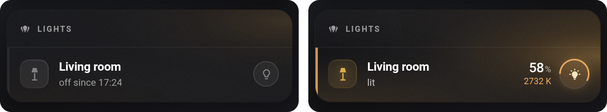
</p>

## Full example dashboard

If you want the whole thing, [Build a dashboard from scratch](docs/build-a-dashboard.md) takes you
through it one card at a time. You start with a new, empty dashboard and the dark background. Next
is the home page, and then a page for each room, until you have the dashboard in these pictures.
Every step has a block to copy and a picture of what you should end up with. You don't need to know
YAML.

## What you need

You need Home Assistant 2026.9 or later. The cards were designed to be phone-first, and everything
is checked at 375 pixels wide, but they're perfectly happy in a desktop browser too. Bubble Card and
mini-graph-card are optional. See [Companion cards](docs/companions.md) for more about them.

A couple of the cards depend on a particular integration. The weather warnings were built around the
UK Met Office, and the waste card reads
[Waste Collection Schedule](https://github.com/mampfes/hacs_waste_collection_schedule). If you use
something else, look at the card's own page. It tells you what the card needs and what you can do
instead.

## Learn more

- [Getting started](docs/getting-started.md) covers installing, the picture folders and your first
  panel and popup.
- [Build a dashboard from scratch](docs/build-a-dashboard.md) goes through the whole example
  dashboard, step by step.
- [How it works](docs/how-it-works.md) explains panels, light, accent colors and popups.
- [Styling](docs/styling.md) has the color palette and shows you how to change the look.
- [Weather sensors](docs/weather-sensors.md) is about what the weather cards read. It includes a full
  Met Office example.
- [Companion cards](docs/companions.md) is where Bubble Card and mini-graph-card come in.

## About the pictures

The weather card has 28 sky pictures. They were all made with an AI image generator (ChatGPT) and
then cut to size, which is worth being upfront about. The window pictures are drawn by a program.
The room in the banner is a small scene made in Blender, though the two cards on its wall are real
screenshots. Everything else is drawn in code by the cards themselves.

## Licence

Lamplight is free to use under the [MIT licence](LICENSE), and that includes both the code and the
pictures.
