# Build a dashboard from scratch

On this page you'll build the whole Lamplight dashboard from the pictures, one card at a time. You
start with an empty dashboard and a dark background. Next comes the home page, and then a page for
each room.

You don't need to know YAML. Every step has a block to copy and tells you what to change and what
you should end up with.

[← Back to the README](../README.md)

<p align="center">
  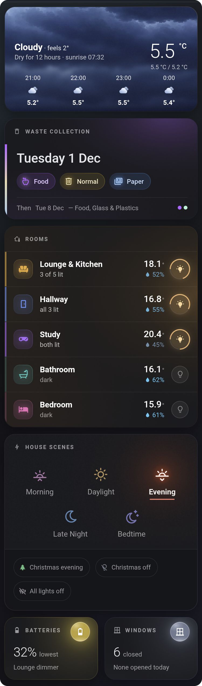
  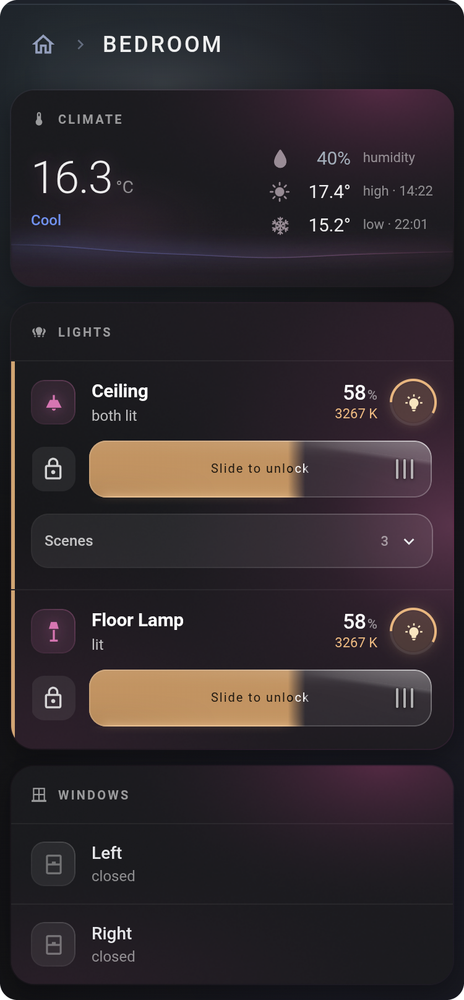
</p>

## Before you start

- **Install Lamplight first.** [Getting started](getting-started.md) shows you how.
- **Gather your entity names.** The examples on this page use made-up names, such as `light.bedroom`
  or `sensor.bedroom_temperature`, and you need to change each one to your own. To find yours, go to
  **Settings > Devices & services > Entities** and search.
- **Skip what you don't have.** If you have no bin sensors, leave out the bins. If you have no
  window sensors, leave out the windows. Every card works on its own.
- **Use dark mode.** Lamplight is made for a dark screen. If your Home Assistant looks light, open
  your profile (your name at the bottom of the sidebar) and switch the theme to dark.

To make it look like the pictures, you'll need two extra cards, but both are optional:

- [layout-card](https://github.com/thomasloven/lovelace-layout-card) keeps everything in one neat
  column, even on a computer.
- [Bubble Card](https://github.com/Clooos/Bubble-Card) adds the brightness sliders under each light.

You can get both from the Marketplace (HACS on older versions). The details are in [Companion
cards](companions.md).

## Part 1: A new, empty dashboard

### Step 1: Create the dashboard

1. Go to **Settings > Dashboards**.
2. Select **Add dashboard** in the bottom-right corner.
3. Choose **New dashboard from scratch**.
4. Give it the title `Lamplight` and the icon `mdi:lamp`. Leave **Show in sidebar** on.
5. Select **Create**.

Your new dashboard is now in the sidebar. Open it and look at the address bar. Home Assistant has
made an address from the title, something like `/dashboard-lamplight/`. Make a note of it, because
you will need it later for the room buttons.

### Step 2: Add the background and the home page

This step replaces everything in the new, empty dashboard.

1. Select the pencil icon in the top-right corner to start editing.
2. Select the three dots in the top-right corner, then **Raw configuration editor**.
3. Delete everything in the editor and paste this in:

```yaml
title: Lamplight
background: >-
  radial-gradient(circle at 12% 12%, rgba(40, 95, 105, 0.22) 0%, transparent 42%),
  radial-gradient(circle at 88% 78%, rgba(55, 65, 120, 0.18) 0%, transparent 48%),
  radial-gradient(circle at 50% 0%, #16161d 0%, #09090b 62%)
views:
  - title: Home
    path: home
    icon: mdi:home-outline
    type: custom:grid-layout
    layout:
      grid-template-columns: min(400px, 100%)
      place-content: start center
      grid-gap: 0px
    cards: []
```

4. Select **Save**, then close the editor.

The `background` in this example is almost black, with a faint teal glow in the top-left corner and
a faint blue one lower down. The `layout` lines make a single column in the middle of the screen.
It's 400 pixels wide, about the width of a phone, so the dashboard looks the same everywhere.

> [!TIP]
> If you aren't using layout-card, leave out the `type` and `layout` lines. You'll still get one
> column on a phone. On a computer the cards will spread out into several columns.

The page is empty for now. From here on you will add one card at a time.

## Part 2: The home page

Every card on this page is added in the same way:

1. Make sure you're editing (select the pencil icon).
2. Select **Add card**, then search for **Manual** and choose it.
3. Paste in the block, change the entity names to yours, and select **Save**.

New cards go to the bottom of the page, so add them in the order below. You can drag a card if it
ends up in the wrong place.

Some of the steps add a popup as well. A popup card stays hidden until something opens it, so it
doesn't matter where you put it on the page.

### Step 3: The weather

Start with the painted sky, which goes at the top. You need a weather entity with an hourly
forecast. The other sensors are optional, and [Weather sensors](weather-sensors.md) explains where
they come from.

```yaml
type: custom:lamplight-weather
entity: weather.home
feels_like_sensor: sensor.home_feels_like_temperature
uv_sensor: sensor.home_uv_index
gust_sensor: sensor.home_wind_gust
hide_ha_title: true
tap_action:
  action: navigate
  navigation_path: '#today'
```

`hide_ha_title` hides Home Assistant's own title at the top of the screen. The `tap_action` opens
the Today popup. Add that next, as a second Manual card:

```yaml
type: custom:lamplight-popup
hash: '#today'
heading: Home
title: The day ahead
icon: lamp-arc:sun.sun
accent: cornflower.soft
cards:
  - type: custom:lamplight-day
    entity: weather.home
```

<p align="center">
  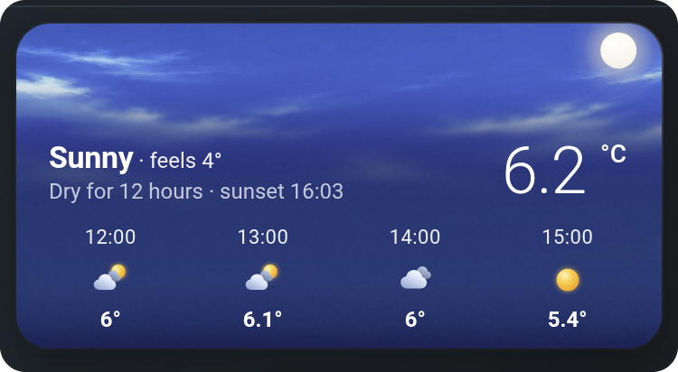
  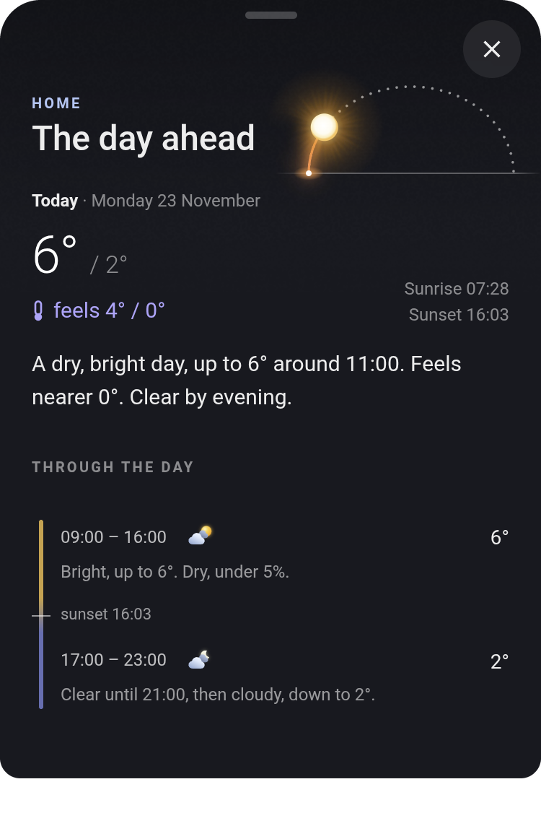
</p>

The popup's title can also change with the time of day. If you want that, replace the
`title` line with this:

```yaml
title: >-
  {{ 'The day ahead' if now().hour < 13
     else ('Tomorrow' if now().hour >= 19 or is_state('sun.sun', 'below_horizon')
     else 'Later today') }}
```

The title will be "The day ahead" in the morning and "Later today" in the afternoon. From 7 in the
evening, or once the sun has set, it's "Tomorrow", because by then the popup is looking ahead to the
next day anyway. Home Assistant updates the title as the day goes on, so you don't have to refresh
anything.

If you have weather warning sensors, add the four `warning_` lines from [Weather
sensors](weather-sensors.md) to both cards. The warnings will then show on both.

### Step 4: The bins

This card needs [Waste Collection
Schedule](https://github.com/mampfes/hacs_waste_collection_schedule), with one sensor for each bin.
See the [Waste](cards/waste.md) page for how to set those up.

```yaml
type: custom:lamplight-waste
light_from: top-edge
heading:
  icon: mdi:delete-outline
  label: Waste Collection
bins:
  - entity: sensor.food_waste
    label: Food
    icon: mdi:food-apple-outline
    color: grape
  - entity: sensor.general_waste
    label: Normal
    icon: mdi:trash-can-outline
    color: mustard
  - entity: sensor.paper_cardboard
    label: Paper
    icon: mdi:newspaper-variant-multiple-outline
    color: bluebell
  - entity: sensor.mixed_recycling
    label: Glass & Plastics
    icon: mdi:recycle
    color: mint
```

Each bin has its own name, icon and color. The color names are from the
[palette](styling.md#colors-by-name).

<p align="center">
  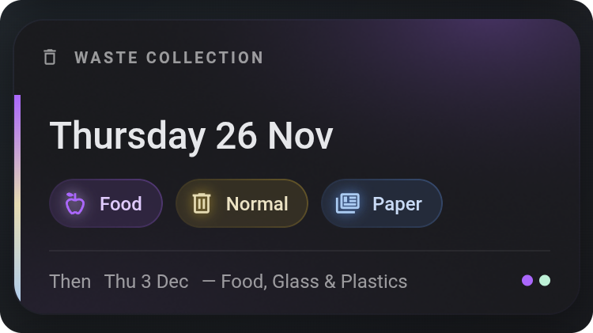
</p>

### Step 5: The rooms

This card has one row for each room, with its lights, temperature and humidity. Tapping a row opens
the room's own page. You will make those pages in Part 3, so for now the taps won't go anywhere.

```yaml
type: custom:lamplight-rooms
accent: 255,146,28
heading:
  icon: mdi:home-thermometer-outline
  label: Rooms
rooms:
  - name: Lounge & Kitchen
    icon: mdi:sofa
    accent: marigold
    light: light.lounge
    temperature: sensor.lounge_temperature
    humidity: sensor.lounge_humidity
    tap_action:
      action: navigate
      navigation_path: /dashboard-lamplight/lounge
  - name: Bedroom
    icon: mdi:bed
    accent: rose
    light: light.bedroom
    temperature: sensor.bedroom_temperature
    humidity: sensor.bedroom_humidity
    tap_action:
      action: navigate
      navigation_path: /dashboard-lamplight/bedroom
```

Add one block for each of your rooms, starting at `- name:`. Change `/dashboard-lamplight/` to the
address you noted in step 1. Give each room its own `accent`, which is the room's color. You'll use
the same color again on the room's page.

<p align="center">
  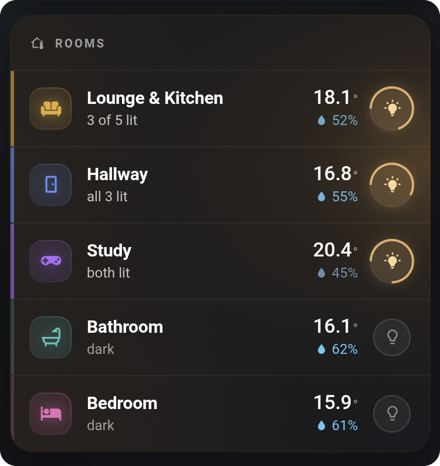
</p>

### Step 6: The house scenes

These are lamps for your everyday routines. Each one runs a script when you tap it, and stays lit
while the lights are still the way that script left them.

```yaml
type: custom:lamplight-panel
light_style: 'off'
heading:
  icon: mdi:lightning-bolt-outline
  label: House Scenes
cards:
  - type: custom:lamplight-routines
    layout: grid
    lamp_style: icon
    lit_lamps: one
    light_spill: true
    routines:
      - entity: script.morning
        name: Morning
        icon: mdi:weather-sunset-up
        accent: heather
        rooms:
          - scene: scene.lounge_bright
            light: light.lounge
      - entity: script.evening
        name: Evening
        icon: mdi:weather-sunset-down
        accent: persimmon
        rooms:
          - scene: scene.lounge_relax
            light: light.lounge
      - entity: script.bedtime
        name: Bedtime
        icon: mdi:weather-night
        accent: periwinkle
        rooms:
          - scene: scene.bedroom_night
            light: light.bedroom
```

Under `rooms`, list the scenes that each script sets, and the light that each scene changes. The
lamp uses these to know when to light up. If you leave out `rooms`, the lamp never lights, but a tap
still runs the script.

<p align="center">
  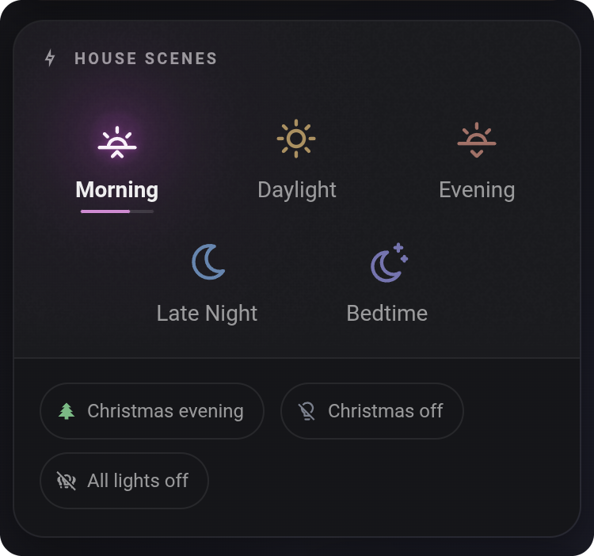
</p>

The example dashboard also has a row of buttons at the bottom. They are a
[`lamplight-chips`](cards/chips.md) card inside the same panel, added to `cards` under the routines.
See [House scenes](cards/house-scenes.md#buttons-under-the-scenes) for how to add them.

### Step 7: Batteries and windows

At the foot of the page are two small panels, side by side. The batteries panel finds every battery
in your home by itself. The windows panel needs your window sensors.

```yaml
type: custom:lamplight-strips
cards:
  - type: custom:lamplight-battery-strip
  - type: custom:lamplight-window-strip
    weather: weather.home
    rooms:
      - name: Lounge & Kitchen
        windows:
          - entity: binary_sensor.lounge_window
            name: Lounge
      - name: Bedroom
        windows:
          - entity: binary_sensor.bedroom_window_left
            name: Bedroom left
          - entity: binary_sensor.bedroom_window_right
            name: Bedroom right
```

Tapping a panel opens its popup, `#batteries` or `#windows`. Add both of these as two more Manual
cards:

```yaml
type: custom:lamplight-popup
hash: '#batteries'
heading: House
title: Batteries
icon: lamp:battery
accent: 78,200,130
header_art: live
cards:
  - type: custom:lamplight-batteries
```

```yaml
type: custom:lamplight-popup
hash: '#windows'
heading: House
title: Windows
icon: lamp:window
accent: panel-rest
header_art: live
cards:
  - type: custom:lamplight-windows-detail
    weather: weather.home
    rooms:
      - name: Lounge & Kitchen
        windows:
          - entity: binary_sensor.lounge_window
            name: Lounge
      - name: Bedroom
        windows:
          - entity: binary_sensor.bedroom_window_left
            name: Left
          - entity: binary_sensor.bedroom_window_right
            name: Right
```

<p align="center">
  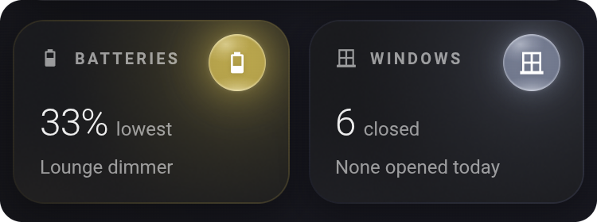
</p>

If phones or watches show up in the batteries list, add `exclude` with their sensors to both battery
cards. The [Batteries](cards/batteries.md) page has an example.

### Step 8: A little space at the end

The last card is a spacer, which keeps the bottom panels away from the edge of the screen:

```yaml
type: custom:lamplight-spacer
```

The home page is done. Turn on a light and watch its room light up.

## Part 3: A page for each room

Each room has a page of its own. The example here is the bedroom, with a header, the climate, the
lights and the windows. The other rooms work the same way, with whatever is in that room.

### Step 9: Add the room's page

Room pages are subviews, which means that they aren't in the row of tabs at the top. You open one
from the rooms card, and it has a back arrow to take you home.

1. Open the **Raw configuration editor** again (the three dots, while you're editing).
2. Find the end of the file and paste this in, lined up with `- title: Home`:

```yaml
  - title: Bedroom
    path: bedroom
    icon: mdi:bed
    subview: true
    back_path: /dashboard-lamplight/home
    type: custom:grid-layout
    layout:
      grid-template-columns: min(400px, 100%)
      place-content: start center
      grid-gap: 0px
    cards: []
```

3. Change `/dashboard-lamplight/` to your address, then select **Save**.

The `path` has to match the end of the `navigation_path` that you gave the room in step 5. If you
tap the bedroom on the rooms card now, its new, empty page will open.

### Step 10: The header

The header has the room's name at the top, with a home button. It glows softly when a light in the
room is on.

```yaml
type: custom:lamplight-header
name: Bedroom
hide_ha_title: true
back:
  label: Home
  navigation_path: /dashboard-lamplight/home
lights:
  - light.bedroom
```

Note that there is no `accent` here. The header's glow is the same soft silver in every room. It
tells you that a light is on, and the panels below show the room's color.

<p align="center">
  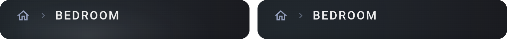
</p>

### Step 11: The climate

This shows the room's temperature and humidity, in a panel of the room's color. Tap it to see the
last 24 hours in a popup.

```yaml
type: custom:lamplight-panel
accent: rose
light_style: accent
light_from: top-edge
heading:
  icon: mdi:thermometer
  label: Climate
cards:
  - type: custom:lamplight-climate
    temperature: sensor.bedroom_temperature
    humidity: sensor.bedroom_humidity
    accent: rose
    tap_action:
      action: navigate
      navigation_path: '#climate-bedroom'
```

This is the popup it opens:

```yaml
type: custom:lamplight-popup
hash: '#climate-bedroom'
heading: Bedroom
title: Climate
icon: lamp:air
accent: rose
header_art: live
cards:
  - type: custom:lamplight-climate-detail
    temperature: sensor.bedroom_temperature
    humidity: sensor.bedroom_humidity
    outside: sensor.home_temperature
    line_color: rose
```

`outside` adds the outdoor temperature to the chart as a dotted line. Leave it out if you don't have
a sensor for it.

<p align="center">
  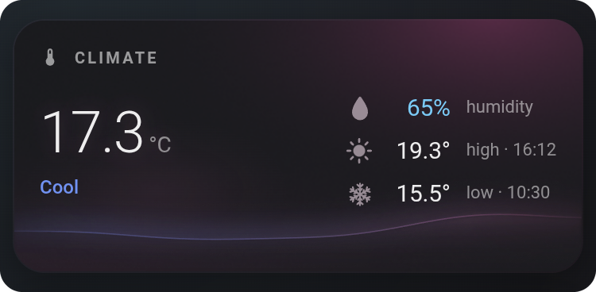
  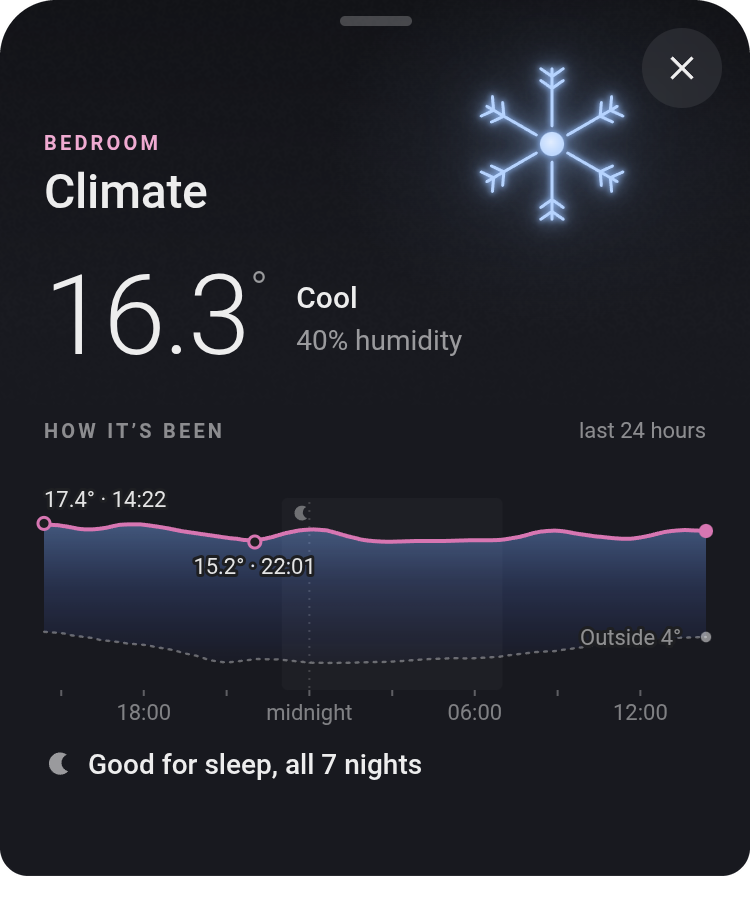
</p>

### Step 12: The lights

Add one row for each light. The panel's light moves towards the ones that are on.

```yaml
type: custom:lamplight-panel
accent: rose
light_from: top-edge
heading:
  icon: mdi:lightbulb-group
  label: Lights
entities:
  - light.bedroom_ceiling
  - light.bedroom_floor_lamp
cards:
  - type: custom:lamplight-light
    light: light.bedroom_ceiling
    name: Ceiling
    icon: mdi:ceiling-light
    accent: rose
    scenes:
      type: custom:lamplight-scenes
      light: light.bedroom_ceiling
      scenes:
        - entity: scene.bedroom_bright
          name: Bright
        - entity: scene.bedroom_night
          name: Night glow
  - type: custom:lamplight-light
    light: light.bedroom_floor_lamp
    name: Floor Lamp
    icon: mdi:floor-lamp
    accent: rose
```

List the same lights under `entities` and under `cards`, in the same order. `scenes` adds the
**Scenes** list under a light and is optional.

<p align="center">
  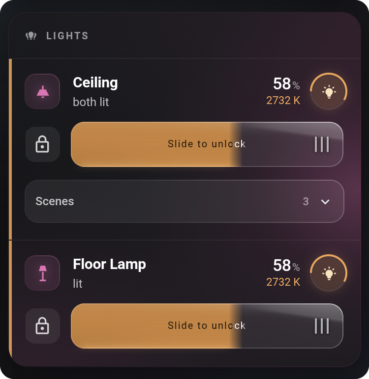
</p>

The sliders in the picture are from Bubble Card. To add them, see [Companion
cards](companions.md#bubble-card-the-brightness-slider).

### Step 13: The windows

Add a row for each window. The panel turns sky blue while a window is open, and a tap opens the
room's windows popup.

```yaml
type: custom:lamplight-panel
light_style: accent
light_from: top-edge
accent:
  pick: first-on
  from:
    - entity: binary_sensor.bedroom_window_left
      accent: window-open
    - entity: binary_sensor.bedroom_window_right
      accent: window-open
  fallback: rose
heading:
  icon: mdi:window-closed-variant
  label: Windows
entities:
  - binary_sensor.bedroom_window_left
  - binary_sensor.bedroom_window_right
cards:
  - type: custom:lamplight-row
    kind: contact
    entity: binary_sensor.bedroom_window_left
    name: Left
    icon: mdi:window-closed
    icon_on: mdi:window-open
    accent: window-open
    tap_action:
      action: navigate
      navigation_path: '#windows-bedroom'
  - type: custom:lamplight-row
    kind: contact
    entity: binary_sensor.bedroom_window_right
    name: Right
    icon: mdi:window-closed
    icon_on: mdi:window-open
    accent: window-open
    tap_action:
      action: navigate
      navigation_path: '#windows-bedroom'
```

The `accent` block looks more complicated than it is. If any window is open, the panel uses the
`window-open` color. Otherwise it uses the room's own `rose`.

This is the popup for it:

```yaml
type: custom:lamplight-popup
hash: '#windows-bedroom'
heading: Bedroom
title: Windows
icon: lamp:window
accent: rose
header_art: live
cards:
  - type: custom:lamplight-windows-detail
    weather: weather.home
    windows:
      - entity: binary_sensor.bedroom_window_left
        name: Left
      - entity: binary_sensor.bedroom_window_right
        name: Right
```

<p align="center">
  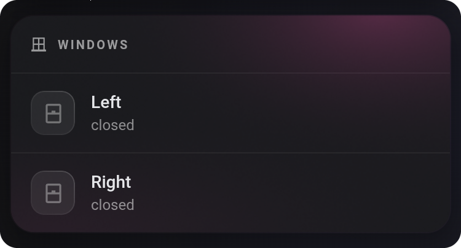
  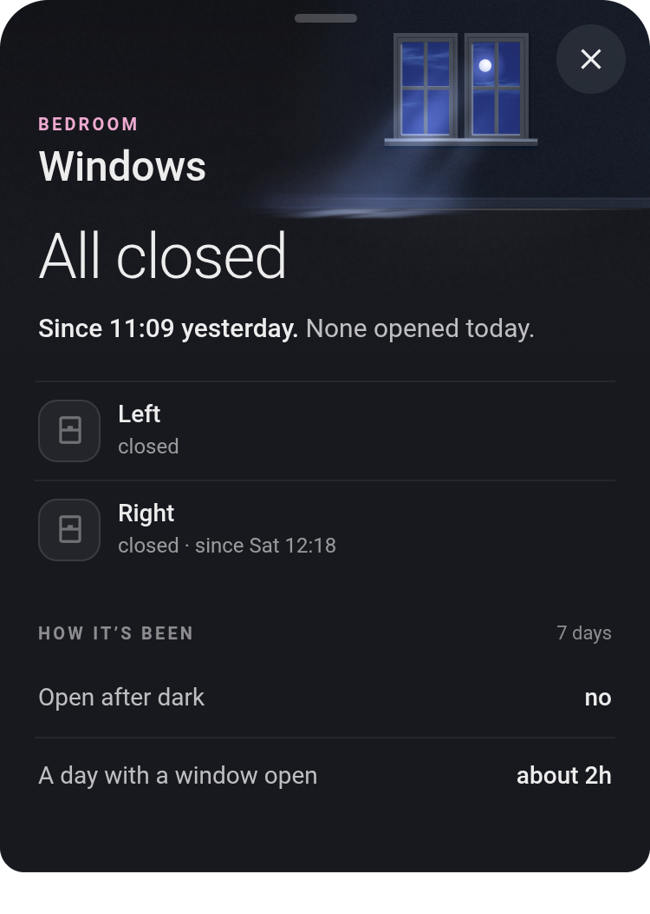
</p>

### Step 14: The spacer

Finish this page in the same way as the home page:

```yaml
type: custom:lamplight-spacer
```

Go back to the home page and tap the bedroom. Its page should open, and the back arrow will take you
home again.

## Part 4: The other rooms

Repeat Part 3 for each room on your rooms card. Copy the bedroom's cards, then change the room's
name, its color and its entities. Leave out anything the room doesn't have. The example hallway, for
instance, only has a climate panel and a lights panel.

You can add other rows to a room too. The example lounge has smart plugs that show their wattage,
and an air purifier. See [Smart plugs](cards/smart-plugs.md) and [Popups](cards/popups.md) for how
to add them.

These are four of the example room pages, with the lights on:

<table>
  <tr>
    <td valign="top">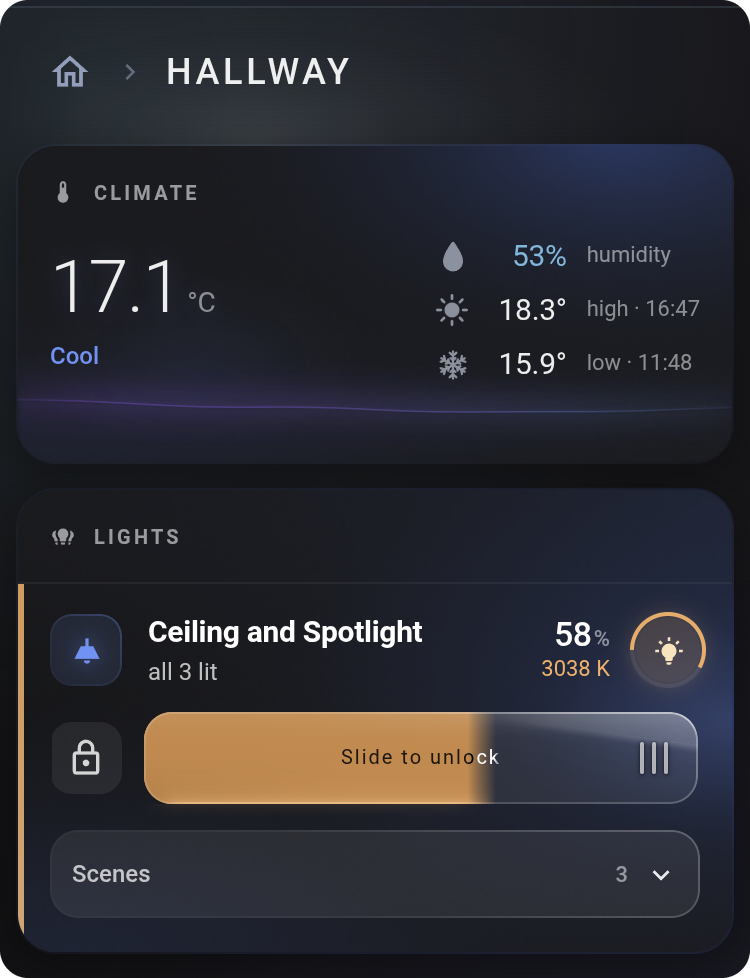</td>
    <td valign="top">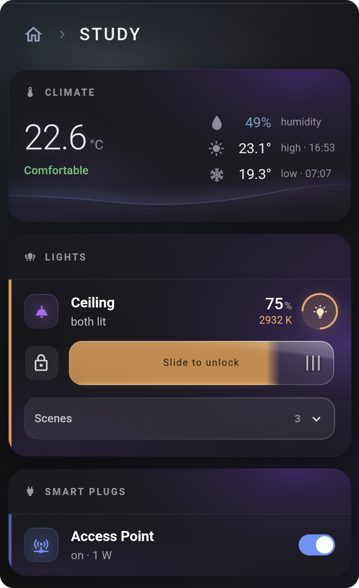</td>
    <td valign="top">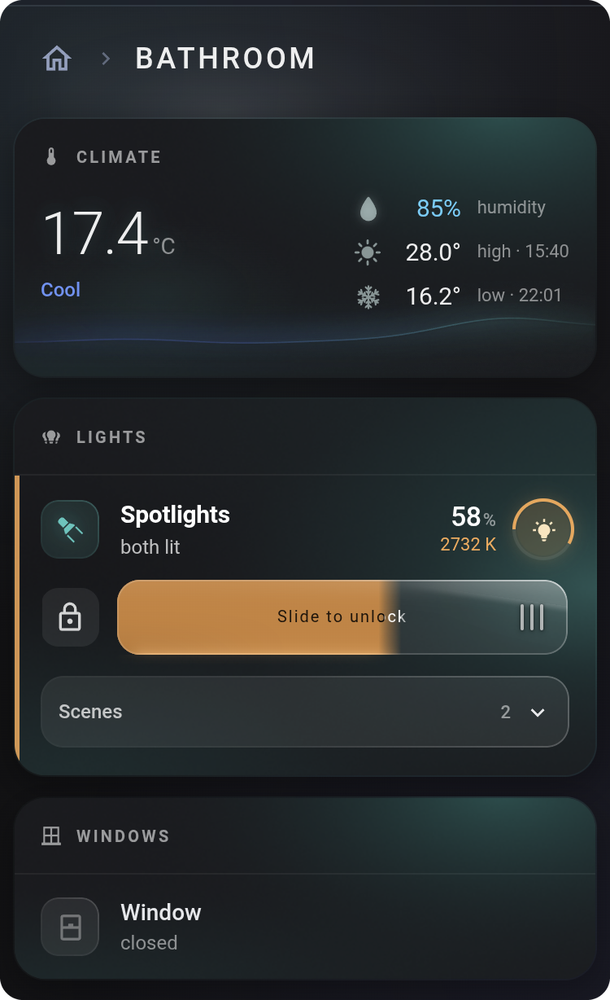</td>
    <td valign="top"></td>
  </tr>
</table>

## If something goes wrong

| What you see | What to do |
|---|---|
| A red box that names a missing key | Add the key it names. The error always says which one. |
| "Custom element doesn't exist" | Lamplight isn't loading. Go back to [Getting started](getting-started.md#check-that-it-works). |
| "Custom element doesn't exist: grid-layout" | layout-card isn't installed. Install it, or leave out the `type` and `layout` lines. |
| A tap on a room does nothing | Check that the `navigation_path` on the rooms card matches your address and the room's `path`. |
| A tap on a panel doesn't open its popup | The popup's `hash` has to match the `navigation_path` exactly, and both cards must be on the same page. |
| The page is light grey, not dark | Switch the theme in your profile to dark. |
