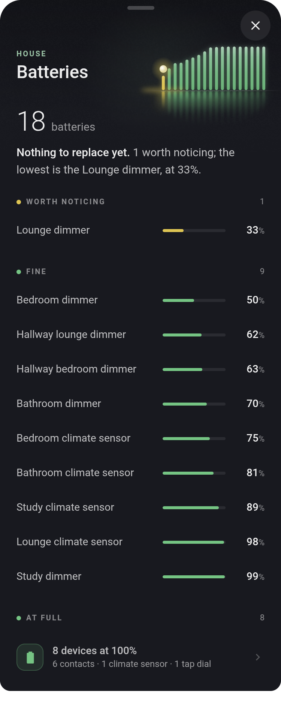
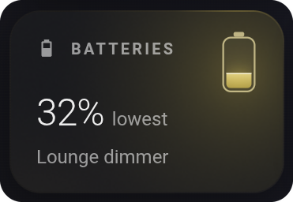

# Batteries

`lamplight-battery-strip` · `lamplight-batteries`

A small panel for the foot of your main view, and a popup with the details. Use them to see which
battery to change next.

[← Back to the README](../../README.md)

<p align="center">
  
</p>

## Putting it together

The strip opens a popup called `#batteries`, so put this popup on the same view:

```yaml
- type: custom:lamplight-battery-strip
- type: custom:lamplight-popup
  hash: '#batteries'
  title: Batteries
  icon: 'lamp:battery'
  accent: '78,200,130'
  header_art: live
  cards:
    - type: custom:lamplight-batteries
```

The battery strip looks best side by side with the window strip, in a
[`lamplight-strips`](panel.md#lamplight-strips) card. See the
[Windows](windows.md#putting-it-together) page for how to do that.

## lamplight-battery-strip

### What it does

A small panel with a battery drawn in its corner. It shows your lowest battery level in large type
("46% lowest") and names that battery. The drawing fills to the same level in the color of its band,
and the panel's light drops as the charge does. If a battery needs replacing the number turns orange
and the line below tells you which one. Tap the panel to open `#batteries`.

<p align="center">
  
</p>

### You need

- Nothing. It finds your batteries by itself.

### Quick start

```yaml
type: custom:lamplight-battery-strip
```

### More options

<details>
<summary>All the options</summary>

The same keys as `lamplight-batteries` (below), so both show the same list, plus:

| Key | Default | What it does |
|---|---|---|
| `tap_action` | open `#batteries` | What a tap does |

</details>

> [!IMPORTANT]
> The strip and the popup don't share their settings. Use the same `exclude`, `names` and
> `thresholds` for both, or they could disagree about which battery is lowest.

## lamplight-batteries

### What it does

This is the body of the `#batteries` popup. It finds every battery sensor in Home Assistant and
sorts them into Replace soon, Worth noticing and Fine. Full batteries are folded away at the end to
keep the list short. The header shows the batteries themselves, each filled to its level.

### You need

- Nothing. Every sensor with the battery device class is included.

### Quick start

```yaml
type: custom:lamplight-batteries
```

### More options

<details>
<summary>All the options</summary>

| Key | Default | What it does |
|---|---|---|
| `exclude` | none | Batteries to leave out, for example a phone that reports its battery |
| `names` | from the sensor | Better names: `{ entity_id: { name, model, short } }`. `short` is used where space is tight |
| `categories` | the model | A word for each model, for the folded list: `{ "Hue dimmer switch": dimmer }` |
| `thresholds` | `{ replace_soon: 20, worth_noticing: 39, fine: 99 }` | Where each band ends, in % |

</details>

### Example: tidy names

```yaml
type: custom:lamplight-batteries
exclude:
  - sensor.my_phone_battery_level
names:
  sensor.bedroom_dimmer_battery:
    name: Bedroom dimmer
    model: Hue dimmer switch
categories:
  Hue dimmer switch: dimmer
```

### Without the extras

Without `names`, each battery shows the name of its device, so a dimmer's battery just says
"Bedroom dimmer". If a battery isn't part of a device it uses its own name with "Battery" trimmed
off the end.

### Tips

- The battery of a window sensor also shows on its window row, but only at 39% or less. See
  [Windows](windows.md).
