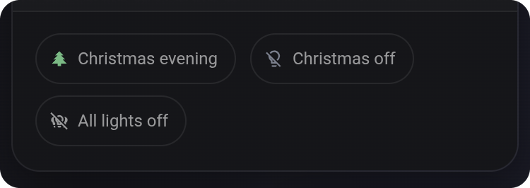
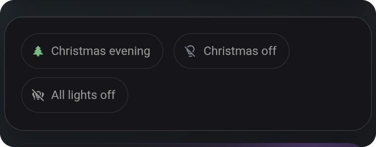

# Chips

`lamplight-chips`

A row of small pill buttons for the things you do most, like a scene for the evening or turning off
every light. You can put the row at the foot of a panel or in a panel of its own anywhere on your
dashboard.

[← Back to the README](../../README.md)

<p align="center">
  
</p>

## lamplight-chips

### What it does

A strip of pill-shaped buttons that run a scene or a script, or open a device. You can set a chip to
only show in certain months so that the heating button isn't there in the summer.

### You need

- The scenes, scripts or devices you want to run.

### Quick start

```yaml
type: custom:lamplight-chips
chips:
  - entity: scene.living_room_relax
  - entity: scene.living_room_bright
  - entity: script.good_night
```

Each chip takes its name and icon from its entity. Tapping a scene or script chip runs it. For
anything else, its details open.

### On its own

The chips don't have to be under another card. To put a row of buttons anywhere on a view, give them
their own `lamplight-panel` with no heading. The panel puts a frame around the row so that it looks
like the rest of your cards.

```yaml
type: custom:lamplight-panel
accent: denim
light_style: 'off'
cards:
  - type: custom:lamplight-chips
    chips:
      - entity: scene.living_room_relax
      - entity: script.good_night
```

<p align="center">
  
</p>

Without the panel, the chips are on a bare strip with a line along the top and square edges. It
works, but it looks unfinished.

### More options

<details>
<summary>All the options</summary>

| Key | Default | What it does |
|---|---|---|
| `chips` | required | The buttons. See the next table |
| `label` | none | A small title in capitals above the chips |
| `months` | all year | The months the whole strip shows, as numbers: `[11, 12, 1, 2, 3]` is November to March |
| `full_width` | `false` | `true` spreads the chips across the whole row |
| `raised` | `false` | `true` gives the chips a stronger border and a soft shadow |

Each chip:

| Key | Default | What it does |
|---|---|---|
| `entity` | required, unless `tap_action` says what to do | The scene, script or device |
| `name`, `icon` | from the entity | Your own words and icon |
| `icon_color` | soft white | The icon's color: any color, or a [palette name](../styling.md#colors-by-name) |
| `tap_action` | run it, or open its details | Any Home Assistant action |
| `months` | the strip's months | The months this chip shows |
| `confirm` | none | Ask before running: `{ title, text, confirm, dismiss }`. `title` is required |

</details>

### Example: a button that asks first

```yaml
type: custom:lamplight-chips
label: Whole home
chips:
  - name: All lights off
    icon: mdi:lightbulb-group-off
    tap_action:
      action: perform-action
      perform_action: light.turn_off
      target:
        entity_id: all
    confirm:
      title: Turn off every light?
      text: This turns off all the lights in the home.
      confirm: Turn off
      dismiss: Cancel
```

### Without the extras

A chip isn't shown outside its months. If that leaves no chips at all, the whole strip hides and
doesn't leave a gap.
