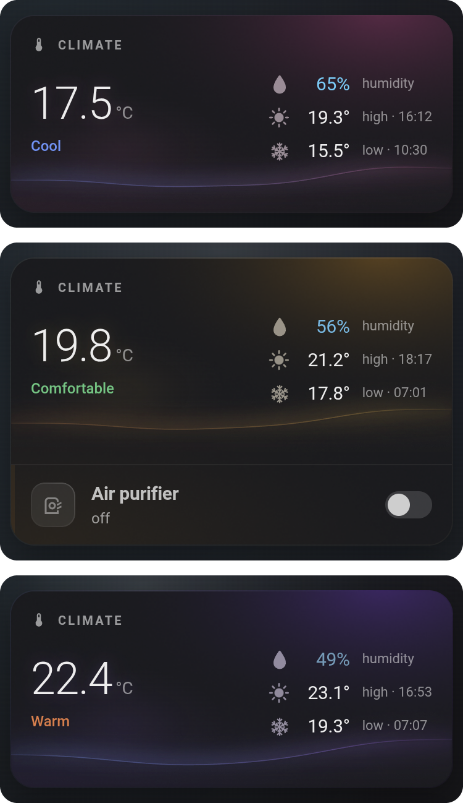
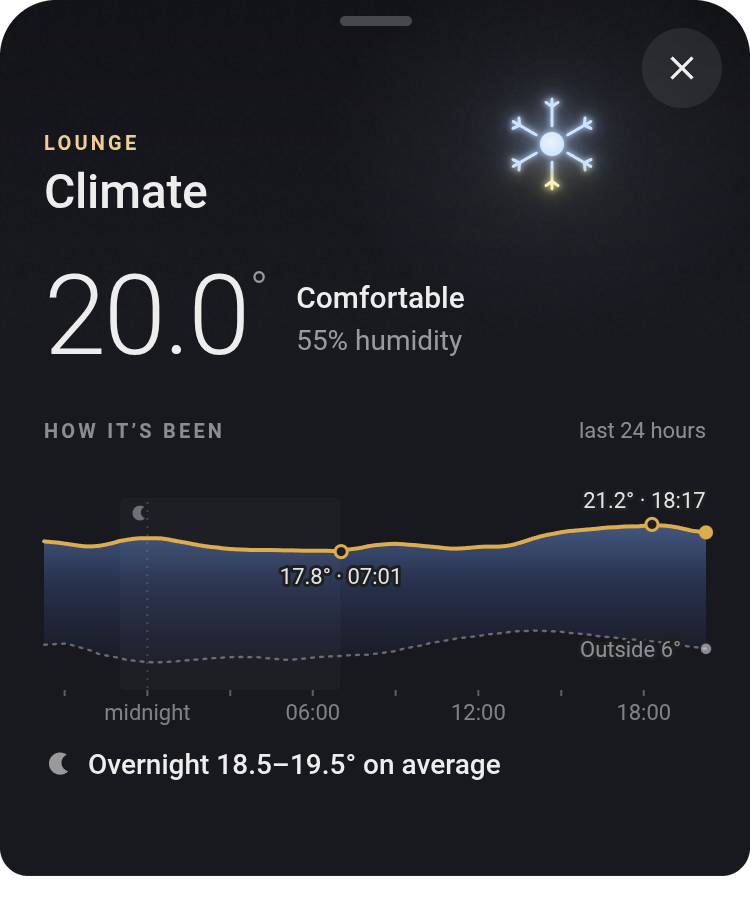
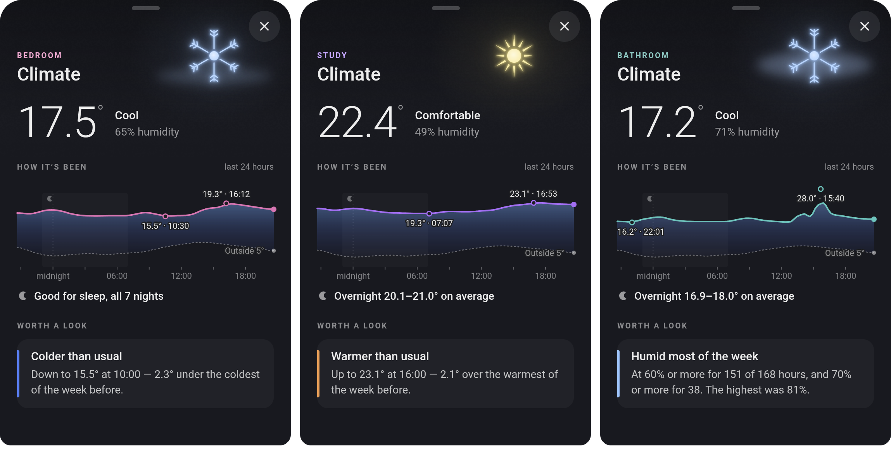

# Climate

`lamplight-climate` · `lamplight-climate-detail`

These cards show how warm a room is, how damp it is, and whether it feels comfortable. The popup
explains the last day in plain words.

[← Back to the README](../../README.md)

<p align="center">
  
</p>

## lamplight-climate

### What it does

A row with the temperature now and a comfort word below it ("Cool", "Comfortable" or "Warm"). The
humidity is on the right, with the high and low of the last 24 hours and their times. A soft wave
along the bottom, in the room's color, traces the same 24 hours.

This is a row and not a panel, so put it inside a [`lamplight-panel`](panel.md).

### You need

- A temperature sensor.
- Optional: a humidity sensor.
- Home Assistant's history (the recorder, which is on by default), for the wave and the high and low.

### Quick start

```yaml
type: custom:lamplight-panel
accent: lagoon
light_style: accent
heading:
  icon: mdi:thermometer
  label: Climate
cards:
  - type: custom:lamplight-climate
    temperature: sensor.living_room_temperature
    humidity: sensor.living_room_humidity
    accent: marigold
```

Give each row its room's color, so that the wave matches the lights in that room.

### More options

<details>
<summary>All the options</summary>

| Key | Default | What it does |
|---|---|---|
| `temperature` | required | The temperature sensor |
| `humidity` | none | The humidity sensor |
| `accent` | `90,150,245` | The room's color, for the wave and the glow under the number |
| `comfort_range` | `[18, 25]` | Below the first number is "Cool", above the second is "Warm" (°C) |
| `comfort_words` | Cool, Warm, Comfortable | Your own words: `{ cool, warm, comfortable }` |
| `comfort_colors` | the [comfort colors](../styling.md#reserved-styles) | Your own colors: `{ cool, warm, comfortable }` |
| `humidity_range` | `[45, 65]` | The dry and damp ends of the humidity color |
| `humidity_colors` | three blues | The humidity color: dry, middle, damp |
| `damp_range` | `[60, 70]` | The drop icon glows from the second number (%) |
| `hot_icon_color`, `cold_icon_color`, `humid_icon_color` | soft white | The colors of the sun, frost and drop icons |
| `show_wave` | `true` | `false` hides the 24-hour wave |
| `tap_action` | open the temperature's details | Any Home Assistant action. Point it at a popup to open the room's climate sheet |

</details>

### Without the extras

Without `humidity`, the row only shows the temperature, the high and the low. On a new install,
you'll see the wave and the high and low once there is some history to draw from.

### Tips

- In a cold climate, try `comfort_range: [17, 23]`. In a warm one, `[20, 27]`.
- To open the room's climate popup from the row, add
  `tap_action: { action: navigate, navigation_path: '#living-room-climate' }`.

## lamplight-climate-detail

### What it does

This is the body of a room's climate popup. I built it around the questions you would actually ask
about a room.

The first is how it feels now. The temperature is in large type, with the comfort word and the
humidity beside it. The next is how it's been. For that there is a chart of the last 24 hours, which
shades the night, marks the high and low, and shows the outside temperature as a faint dotted line.
Below it is one line about the nights.

After that comes anything worth a look, but only if there is something: the room has stayed humid
all week, or it's been much colder or warmer than the week before. You won't see this part on a
normal day.

The picture at the top of the popup is made from the room. Below 20.5° it's a frost crystal, which
grows as the room cools. From 20.5° it's a sun, which grows and turns from pale yellow to amber as
the room warms. If the air is damp, a soft mist gathers under it.

<p align="center">
  
</p>

The three rooms below each have something worth a look. The bedroom is cool and a little damp, and
colder than usual. The study is warm, and warmer than usual. The bathroom has been humid for most of
the week, so the mist under its crystal is thicker.

<p align="center">
  
</p>

### You need

- The same temperature sensor as the room's row.
- Optional: a humidity sensor and an outside temperature sensor.
- About 8 days of history before the "worth a look" checks can compare with the week before.

### Quick start

Put it in a [`lamplight-popup`](popups.md):

```yaml
type: custom:lamplight-popup
hash: '#living-room-climate'
title: Living room
heading: Climate
icon: 'lamp:thermometer'
accent: marigold
header_art: live
cards:
  - type: custom:lamplight-climate-detail
    temperature: sensor.living_room_temperature
    humidity: sensor.living_room_humidity
    outside: sensor.outside_temperature
    line_color: marigold
```

### More options

<details>
<summary>All the options</summary>

| Key | Default | What it does |
|---|---|---|
| `temperature` | required | The temperature sensor |
| `humidity` | none | The humidity sensor |
| `outside` | none | The outside temperature sensor, drawn as a dotted line |
| `line_color` | white | The color of the room's line in the chart |
| `bedroom` | `false` | `true` for a bedroom: the nights line says how many nights were cool enough to sleep well |
| `sleep_max_temp` | `20` | A night warmer than this on average is too warm for sleep (°C) |
| `night_hours` | `[23, 7]` | When night starts and ends, for the shading |
| `damp_range` | `[60, 70]` | The humidity bands for "humid" (%) |
| `comfort_range`, `comfort_words` | as the row | The same as on `lamplight-climate` |
| `graph` | none | Any card for the foot of the sheet, for example a [mini-graph-card](../companions.md#mini-graph-card-graphs-in-the-popups) |

</details>

### Without the extras

Without `humidity`, there is no humidity reading and no "humid" note. Without `outside`, the chart
only shows the room. If you leave out `graph`, the sheet ends after its own chart.
