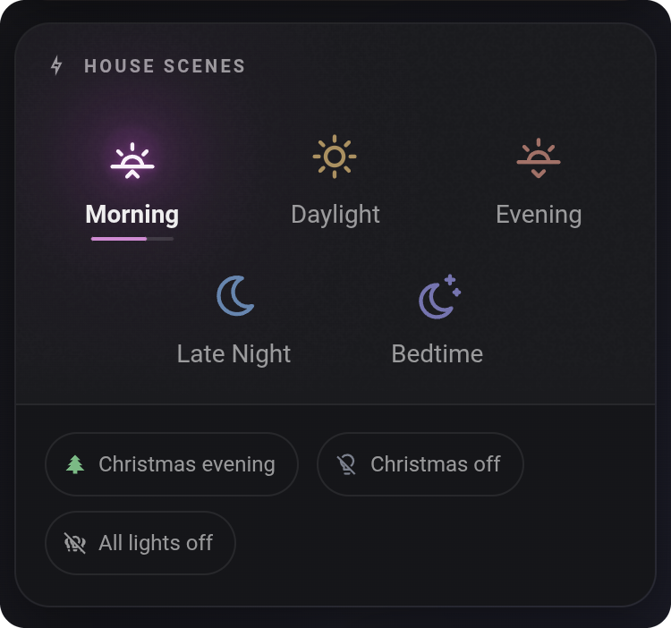
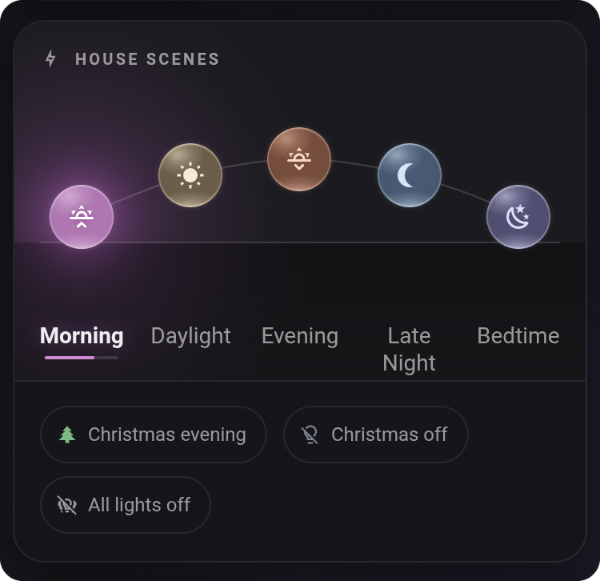
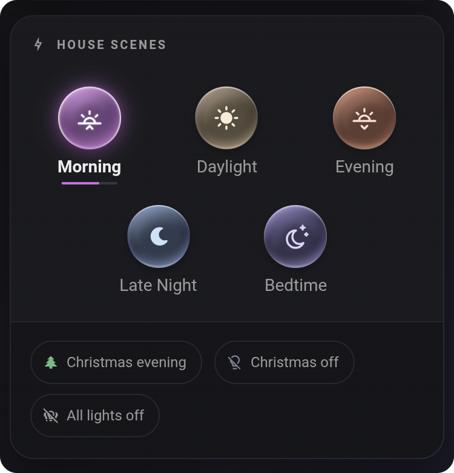

# House scenes

`lamplight-routines`

This card shows your everyday routines (Morning, Evening, Good night and so on) as a row of lamps.
Tap a lamp to run its routine. It stays lit for as long as your home is still set the way that
routine left it.

[← Back to the README](../../README.md)

<p align="center">
  
</p>

## What it does

Each routine is a lamp with its name underneath, and tapping it runs the script. The lamp glows in
its color while the scenes it set are still in place. If you change some of those lights by hand,
the lamp dims and a short line under the name shows how much of the routine is still set.

The lamps can be placed along a curved path through the day or in a grid. The path is the default.
On it, each routine is a glass lamp. They rise from Morning to Evening and set again towards
Bedtime, with the names on the land below the horizon.

<p align="center">
  
</p>

In the grid (`layout: grid`), each lamp can be a backlit line icon, like the picture at the top, or
a glass orb if you use `lamp_style: orb`. There is an orb for every palette color apart from the
four waste bin ones. A raw color like `250,152,30` has no orb and will show an error.

<p align="center">
  
</p>

## You need

- A script for each routine.
- Optional, for the lamps to light up: the scenes each routine sets, and the light each scene
  changes.

> [!IMPORTANT]
> A lamp knows that a scene is still set by comparing the brightness of each light with the scene's.
> Philips Hue scenes report a brightness, so they work well. Scenes from some other integrations
> don't, and then the lamp never lights up. You won't get a warning about it.

## Quick start

A grid of icons, with the backlit look:

```yaml
type: custom:lamplight-panel
accent: honey
light_style: 'off'
heading:
  icon: mdi:home-lightbulb-outline
  label: House scenes
cards:
  - type: custom:lamplight-routines
    layout: grid
    lamp_style: icon
    routines:
      - entity: script.good_morning
        accent: honey
        rooms:
          - scene: scene.living_room_bright
            light: light.living_room
      - entity: script.good_night
        accent: periwinkle
        rooms:
          - scene: scene.living_room_relax
            light: light.living_room
```

Each routine takes its name and icon from its script. To use your own, add `name:` and `icon:`.

## Buttons under the scenes

In the pictures, the row of buttons under the lamps is a second card in the same panel. It's a
[`lamplight-chips`](chips.md) card. It has a slightly darker strip behind it and a thin line above,
so the buttons look like part of the panel but are kept apart from the routines.

Add it to `cards` in the panel, under the routines:

<details>
<summary>Show the YAML (38 lines)</summary>

```yaml
type: custom:lamplight-panel
accent: honey
light_style: 'off'
heading:
  icon: mdi:home-lightbulb-outline
  label: House scenes
cards:
  - type: custom:lamplight-routines
    layout: grid
    lamp_style: icon
    routines:
      - entity: script.good_morning
        accent: honey
      - entity: script.good_night
        accent: periwinkle
  - type: custom:lamplight-chips
    months: [11, 12, 1]
    chips:
      - entity: script.christmas_evening
        name: Christmas evening
        icon: mdi:pine-tree
        icon_color: '#62be85'
      - entity: script.christmas_lights_off
        name: Christmas off
        icon: mdi:lightbulb-off-outline
      - name: All lights off
        icon: mdi:lightbulb-group-off-outline
        months: [1, 2, 3, 4, 5, 6, 7, 8, 9, 10, 11, 12]
        tap_action:
          action: perform-action
          perform_action: light.turn_off
          target:
            entity_id: all
        confirm:
          title: Turn off all the lights?
          text: Every light in the house will be switched off.
          confirm: Turn off
          dismiss: Keep them on
```

</details>

Tapping a script or scene chip runs it. Anything else opens its details unless the chip has its own
`tap_action`, like the **All lights off** button above.

### Showing buttons only in some months

`months` is a list of month numbers, from 1 for January to 12 for December. A button is only there
in the months on its list. For the rest of the year, the other buttons close up so there isn't a
gap.

You can put `months` in two places:

- **On the whole card**, under `type`. Every button follows it unless it has a list of its own.
- **On one button.** The button uses its own list in place of the card's list. They aren't added
  together.

This is what happens in the example above. The card has `[11, 12, 1]`, so the two Christmas buttons
show from November to January. **All lights off** lists all twelve months, so it ignores the card's
list and stays all year. If every button is out of season at once, the whole strip hides, including
the line.

A list doesn't have to be in order, and the months don't have to be next to each other. For example,
`[12, 1, 2]` is winter and `[6, 7, 8]` is summer. The card takes the month from the phone or
computer it's showing on. A new month starts at midnight and you don't have to reload.

### Asking before a button acts

`confirm` makes a button ask first. A tap opens a small dialog, and nothing happens unless you tap
the confirm button in it.

| Key | Default | What it does |
|---|---|---|
| `title` | required | The question at the top. Ask it plainly, for example "Turn off all the lights?" |
| `text` | none | A line under the question that says what will happen |
| `confirm` | `Turn off` | The words on the button that goes ahead. It's red, because it does something you might not want |
| `dismiss` | `Cancel` | The words on the button that backs out |

Backing out is the easy choice on purpose. The dismiss button is the one that is selected, and a tap
outside the dialog, the back gesture or the Escape key will back out too. Only the confirm button
goes ahead.

It's worth using `confirm` on a button that turns off all the lights in the house, or on anything
else that is annoying to undo by accident.

See the [Chips](chips.md) page for all the chip settings.

## More options

<details>
<summary>All the options</summary>

| Key | Default | What it does |
|---|---|---|
| `routines` | required | The routines, in the order of the day. See the next table |
| `layout` | `path` | `path` (a curve through the day) or `grid` (rows of lamps) |
| `lamp_style` | `glass` | `glass` (a glass lamp), `icon` (a backlit line icon) or `orb` (a glass orb). `icon` and `orb` need `layout: grid` |
| `columns` | `3` | The lamps in each row of the grid |
| `lit_lamps` | `all` | `one` lights only the routine that is most fully set |
| `light_spill` | `false` | `true` lets the lit icon's light spill softly across the card. Only with `lamp_style: icon` |
| `brightness_tolerance` | `3` | How close a light's brightness must be to the scene's, from 0 to 255 |

Each routine:

| Key | Default | What it does |
|---|---|---|
| `entity` | required | The script. A tap runs it |
| `accent` | required | The lamp's color. A [palette name](../styling.md#colors-by-name) also gives the matching glow and glass |
| `name`, `icon` | from the script | Your own words and icon. `name` can also use [name parts](../how-it-works.md#names-and-icons) |
| `rooms` | none | The scenes this routine sets: `{ scene, light }` for each |
| `glow_color`, `glass_color`, `glass_tint` | from the accent | Fine-tune the lamp's colors |
| `lamp_height` | built in | On the path, how high the lamp sits, in pixels from the top |
| `tap_action` | run the script | Any Home Assistant action |

</details>

## Without the extras

Without `rooms`, a lamp never lights up. A tap still runs the routine.

## Tips

- Put the card in a panel with `light_style: 'off'`, because the lamps have their own light.
- Two routines can set the same scene, so you might see two lamps lit at once. If you only want one,
  use `lit_lamps: one`.
- The `orb` style works with any palette color except the four waste bin ones (`grape`, `mustard`,
  `bluebell` and `mint`). Five of the orbs (`heather`, `honey`, `persimmon`, `cerulean` and
  `periwinkle`) were matched to reference pictures. The rest are worked out from whichever of those
  five is closest in color so that they look like part of the same set.
