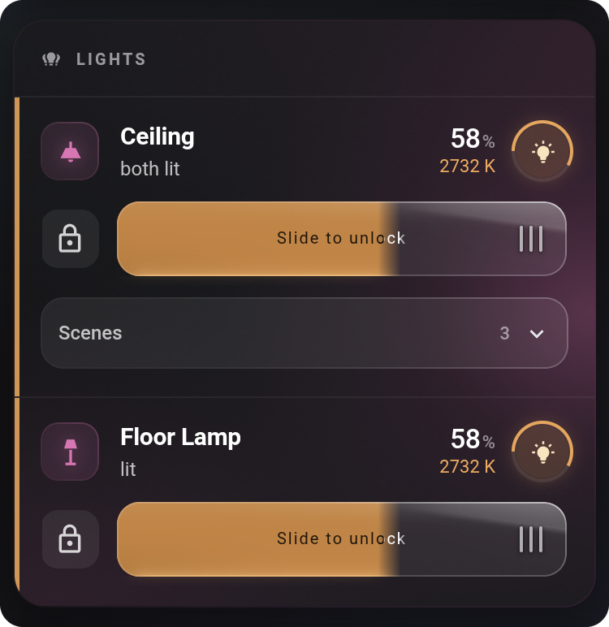
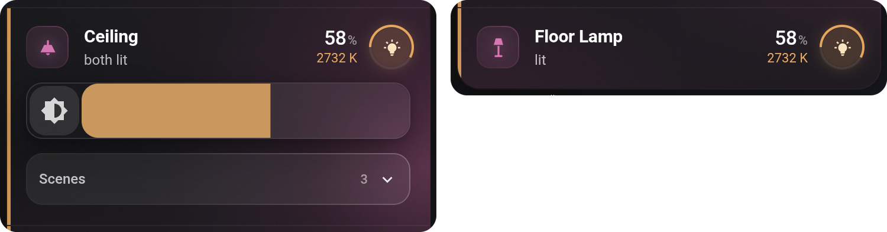
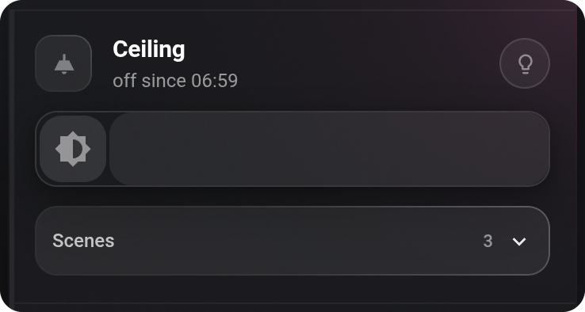
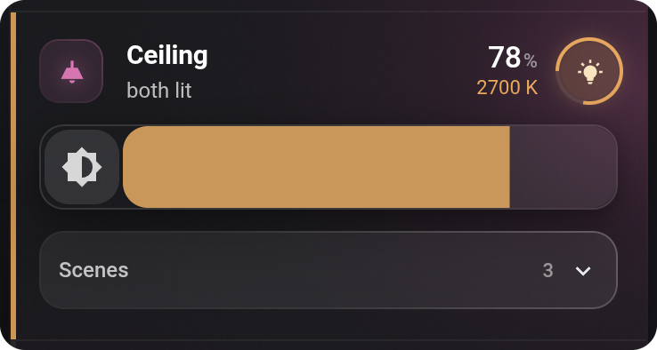
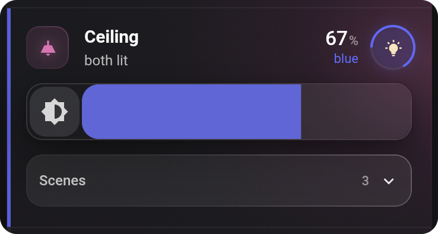
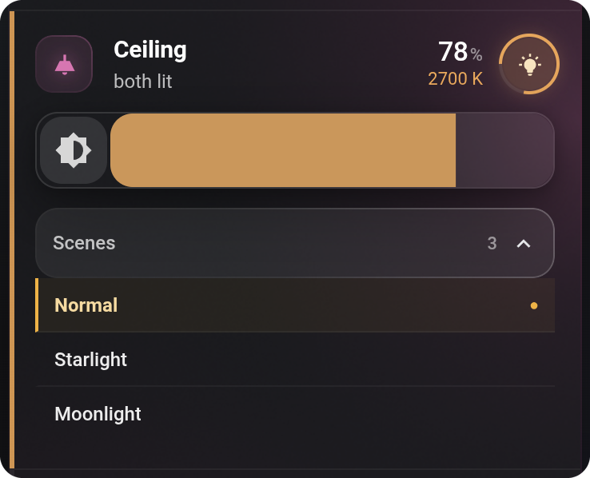

# Lights

`lamplight-light` · `lamplight-scenes`

A row for each light, with its brightness and color, and a list for your scenes that folds away.

[← Back to the README](../../README.md)

<p align="center">
  
</p>

## lamplight-light

### What it does

A row for one light or light group. It shows the light's name, how many bulbs are lit ("2 of 3
lit"), the brightness, and the color in words. On the right is a round toggle, with a ring that
fills with the brightness. The thin bar down the left edge glows in the bulbs' real colors.

There is space under the name for two optional extras: a brightness slider and a list of scenes.

<p align="center">
  
</p>

This is the same row three times: off, on in warm white, and on in blue. The ring, the slider and
the bar down the left edge take the color of the bulbs, whatever it is. When the light is off, the
line under the name tells you when it went off.

<p align="center">
  
  
  
</p>

### You need

- A light or a light group.
- Optional: [Bubble Card](../companions.md#bubble-card-the-brightness-slider), for the slider.

### Quick start

```yaml
type: custom:lamplight-light
light: light.living_room
accent: marigold
```

With a slider and scenes:

```yaml
type: custom:lamplight-light
light: light.living_room
accent: marigold
slider:
  type: custom:bubble-card
  card_type: button
  button_type: slider
  entity: light.living_room
  icon: mdi:brightness-6
  modules:
    - lamplight-slider
scenes:
  type: custom:lamplight-scenes
  light: light.living_room
  scenes:
    - entity: scene.living_room_relax
    - entity: scene.living_room_bright
```

### More options

<details>
<summary>All the options</summary>

| Key | Default | What it does |
|---|---|---|
| `light` | required | The light or light group |
| `accent` | required | The color of the icon tile |
| `name`, `icon` | from the light | Your own words and icon |
| `members` | the group's members | The bulbs to count. List them for a light group (see Tips) |
| `side_bar` | `members` | The bulbs whose colors show in the left bar, top to bottom |
| `side_bar_opacity` | `[0.14, 0.85]` | The left bar when the bulb is off and when it is on. `false` hides it |
| `side_bar_default_color` | grey | The bar for a bulb that doesn't report a color |
| `toggle_color` | warm white | The toggle for a light that doesn't report a color |
| `toggle_icon_color_on` | warm white | The icon inside a lit toggle |
| `icon_on`, `icon_off` | light bulbs | The toggle's icon when on and when off |
| `slider` | none | A card for the slider slot |
| `scenes` | none | A card for the scenes slot, usually `lamplight-scenes` |
| `slider_lock` | off | `true` puts a glass cover over the slider. See [Companion cards](../companions.md#two-slider-extras) |
| `scroll_guard_ms` | `500` | After you scroll, a touch on the slider is ignored for this long. `0` turns it off |
| `tap_action` | open the light's details | What a tap does |
| `tap_area` | `icon` | `icon` or `row`: where a tap counts |
| `effect_colors` | none | A color for a light effect, for example `{ Candle: honey }`. Use `white` for an effect that is white light |
| `words` | built in | The words on the lit-count line |

</details>

### Without the extras

Without `slider` and `scenes`, the row is shorter. Everything else is still there, including a
working toggle.

### Tips

- Home Assistant reports the average color of a light group, which isn't a color that any bulb is
  actually showing. The row uses the color of the first lit bulb instead. List the bulbs in
  `members` in the order you want, because Home Assistant doesn't keep track of the order.
- The toggle and the slider take the light's real color.
- Some of the pictures show a "Slide to unlock" cover over the slider. This is the optional
  `slider_lock`. If you leave it out, the slider works as soon as you touch it.

## lamplight-scenes

### What it does

A list of scenes that folds away under a single line, "Scenes", with a count beside it. Tap the line
to open it. The active scene is marked. That's the last one used on its light, as long as nobody has
changed the light since.

<p align="center">
  
</p>

The list above is open and Normal is marked, because it was the last scene used on that light and
nobody has changed the light since.

### You need

- One or more scenes. You can create your own or use the ones that come with an integration. See
  [Home Assistant Scenes](https://www.home-assistant.io/integrations/scene/) to learn more about
  them.
- Optional: the light they belong to, to mark the active scene.

### Quick start

Normally you would put it in the `scenes` slot of a [light row](#lamplight-light). This is how to
use it on its own:

```yaml
type: custom:lamplight-scenes
light: light.living_room
scenes:
  - entity: scene.living_room_relax
  - entity: scene.living_room_bright
    name: Bright
```

### More options

<details>
<summary>All the options</summary>

| Key | Default | What it does |
|---|---|---|
| `scenes` | required | The scenes: `{ entity, name }` for each. `name` comes from the scene if you leave it out |
| `light` | none | The light the scenes belong to. Without it, no scene is marked |
| `title` | Scenes | The word on the folded line |
| `icon` | a chevron | The icon on the folded line |
| `accent` | warm orange | The color of the active mark |
| `show_count` | `true` | Show how many scenes there are |
| `expanded` | `false` | Start open |
| `animation` | `true` | Animate opening and closing |
| `remember_open_as` | none | A name to remember whether it's open, in this browser, after a reload |

</details>
