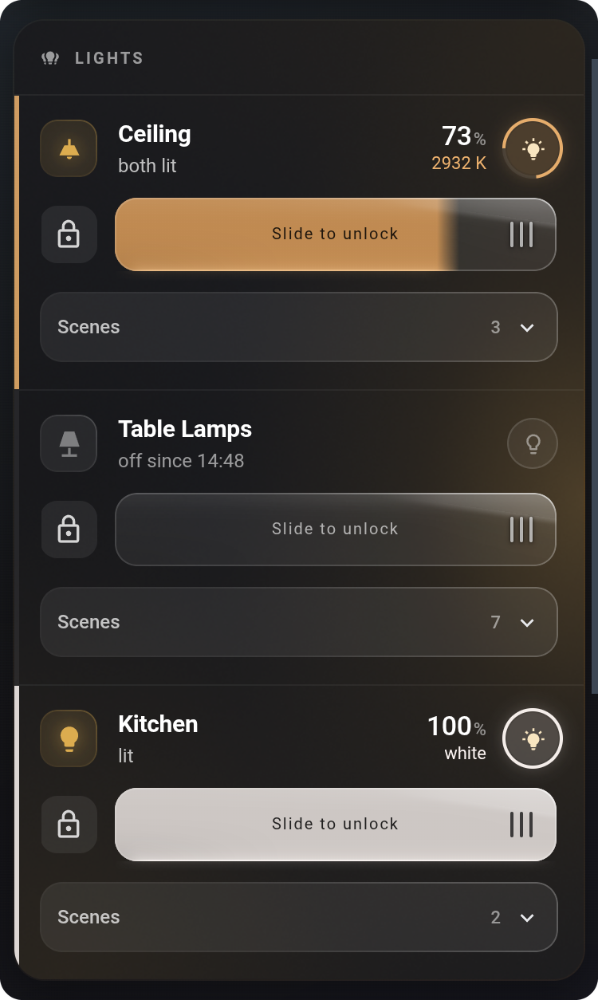

# The panel

`lamplight-panel` · `lamplight-strips` · `lamplight-spacer`

The panel is the glowing background that holds your other cards, and it's the place to start with
Lamplight. This page also covers two small helpers for laying out a view.

[← Back to the README](../../README.md)

<p align="center">
  
</p>

## lamplight-panel

### What it does

A dark panel with a soft rim, and light that falls in from the corner. You can put any cards inside
it. In the default light style, the light moves to the rows that are on, and gets brighter as more
of them are turned on.

### You need

- The cards you want to put inside it.

### Quick start

```yaml
type: custom:lamplight-panel
accent: marigold
heading:
  icon: mdi:lightbulb-group
  label: Lights
entities:
  - light.living_room
  - light.living_room_lamp
cards:
  - type: custom:lamplight-light
    light: light.living_room
    accent: marigold
  - type: custom:lamplight-light
    light: light.living_room_lamp
    accent: marigold
```

### More options

<details>
<summary>All the options</summary>

| Key | Default | What it does |
|---|---|---|
| `accent` | required | The panel's color: a [palette name](../styling.md#colors-by-name), a number, or a [rule](../how-it-works.md#the-accent-color) |
| `cards` | none | The cards inside the panel |
| `heading` | none | A small title at the top: `{ icon, label }` |
| `entities` | none | The things that move the light, in the same order as the rows |
| `light_style` | `activity` | `activity` (follows what's on), `accent` (steady), or `off` |
| `light_from` | `corner` | `corner` or `top-edge`: where the light comes from |
| `restyle_children` | `true` | Give standard cards inside the panel the Lamplight look |
| `smooth_gradient` | `true` | A fine grain that hides color bands |
| `theme` | none | Change the background, radius or text sizes for this panel. See [Styling](../styling.md#changing-the-look) |
| `glow_strength`, `glow_position`, `edge_strength`, `bounce_strength` | built in | Fine-tune the light. Best left alone |
| `gap` | Home Assistant's gap | The space between the cards inside |

</details>

### Without the extras

Without `entities`, an `activity` panel stays in its faint resting glow. It starts to react once you
add them.

### Tips

- I find that one panel for each group of things works best. That could be the living room lights,
  the climate readings or the plugs.
- Use `light_style: accent` for a climate or windows panel. It's easier to read.
- To have the color change when a window opens, use the `first-on` rule. See [How it
  works](../how-it-works.md#the-accent-color).
- You can use standard Home Assistant cards inside a panel too.

## lamplight-strips

### What it does

Puts two cards side by side, with the same gap as the rest of your view. I made it for the battery
strip and the window strip at the foot of a view, but you can use any two cards.

### Quick start

```yaml
type: custom:lamplight-strips
cards:
  - type: custom:lamplight-battery-strip
  - type: custom:lamplight-window-strip
    rooms:
      - name: Bedroom
        windows:
          - entity: binary_sensor.bedroom_window
```

### More options

<details>
<summary>All the options</summary>

| Key | Default | What it does |
|---|---|---|
| `cards` | required | Exactly two cards: left, then right |

</details>

## lamplight-spacer

### What it does

Adds empty space at the foot of a view, so that your last card isn't hidden behind the phone's
bottom bar.

### Quick start

```yaml
type: custom:lamplight-spacer
```

### More options

<details>
<summary>All the options</summary>

| Key | Default | What it does |
|---|---|---|
| `height` | `70px` | The height of the space: a number of pixels, or any CSS length |

</details>
