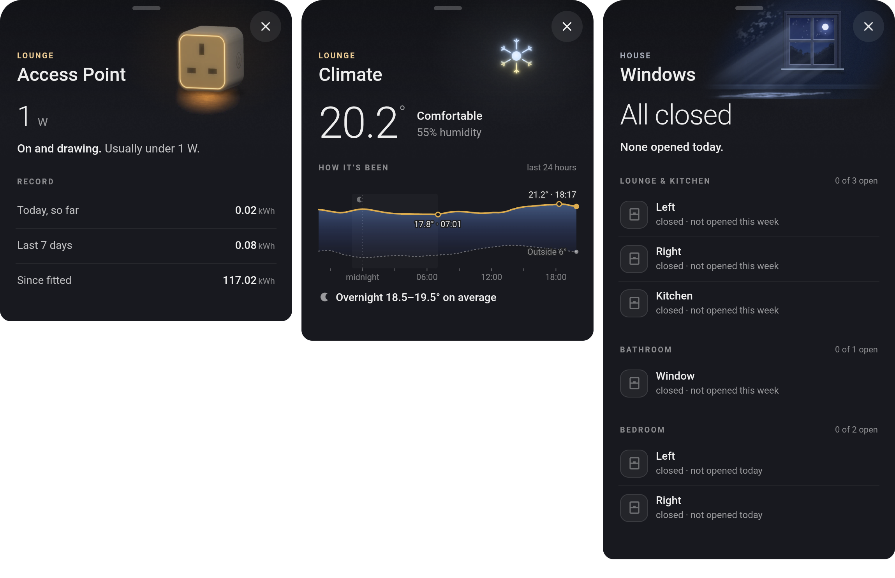

# Popups

`lamplight-popup` · `lamplight-purifier-detail`

A popup is a sheet that slides up from the bottom of the screen with more detail. This page is about
the popup itself, and the popup body for air purifiers.

The other popup bodies are on their own pages: [smart plugs](smart-plugs.md#lamplight-plug-detail),
[Today](weather.md#lamplight-day), [climate](climate.md#lamplight-climate-detail),
[batteries](batteries.md#lamplight-batteries) and [windows](windows.md#lamplight-windows-detail).

[← Back to the README](../../README.md)

<p align="center">
  
</p>

## lamplight-popup

### What it does

A sheet that slides up when the page address ends in its hash, such as `#coffee-machine`. It has a
picture at the top, then the title, then the cards that you put inside. To close it, use the close
button, tap outside it, or use your phone's back gesture.

### You need

- The cards for its body.
- A card that opens it. See [How to open a popup](#how-to-open-a-popup).

### Quick start

```yaml
type: custom:lamplight-popup
hash: '#coffee-machine'
title: Coffee machine
icon: 'lamp:socket'
accent: cornflower
header_art: live
cards:
  - type: custom:lamplight-plug-detail
    entity: switch.coffee_machine
    power_sensor: sensor.coffee_machine_power
    energy_sensor: sensor.coffee_machine_energy
```

### More options

<details>
<summary>All the options</summary>

| Key | Default | What it does |
|---|---|---|
| `hash` | required | The popup's name, starting with `#` |
| `title` | required | The title. It can be a template with `{{ }}` |
| `cards` | none | The cards in the body |
| `heading` | none | A small word above the title, such as "Climate". It can be a template |
| `icon` | none | The picture at the top: a Lamplight drawing (`lamp:battery`, `lamp:window`, `lamp:air`, `lamp:thermometer`, `lamp:socket`, `lamp:access-point`, `lamp:modem`, `lamp:string-lights`) or any `mdi:` icon |
| `accent` | `255,64,160` | The color of the header. Use the color of the panel that opens it |
| `header_art` | none | `live` draws the header from the first card in the body. See below |
| `header_images` | the pictures in `lamplight-windows/` | `{ day, night }` picture addresses for the window headers, or `false` to use the drawings |
| `weather` | the first weather entity | The weather for the window headers |
| `close_by_clicking_outside` | `true` | Close the sheet with a tap outside it |
| `width_desktop` | `540px` | The sheet's width on a large screen |

</details>

### Live headers

With `header_art: live`, the picture at the top of the sheet is made from the card inside it:

| Body card | Header picture |
|---|---|
| `lamplight-plug-detail` | The plug, glowing amber while it uses power. See [Smart plugs](smart-plugs.md#what-youll-see) |
| `lamplight-climate-detail` | A frost crystal when cool, a sun when warm, with mist under it when the air is damp |
| `lamplight-purifier-detail` | A trace of the last 24 hours of air quality |
| `lamplight-batteries` | The batteries, each filled to its level |
| `lamplight-windows-detail` (one room) | The sky through the window panes, with the sun or moon when it's clear. An open window has a soft blue light in the gap |
| `lamplight-windows-detail` (whole home) | Sunlight or moonlight falling into the room |

The header shows the `icon` until the data arrives.

### How to open a popup

Add a `navigate` tap action with the hash to any card:

```yaml
tap_action:
  action: navigate
  navigation_path: '#coffee-machine'
```

The popup has to be on the same view as the card that opens it.

> [!IMPORTANT]
> The hash has to match exactly. If it doesn't there is no warning. The tap just does nothing, which
> can be confusing.

## lamplight-purifier-detail

### What it does

This is the body of an air purifier's popup. The air quality is in large type, with a sentence in
plain words beside it, and the modes are a row of buttons. Each filter has a meter that shows how
long it has until it needs cleaning or replacing.

### You need

- The purifier, as a `fan` entity.
- Optional: an air quality sensor (PM2.5), and a sensor for each filter's life in %.

### Quick start

```yaml
type: custom:lamplight-popup
hash: '#bedroom-air'
title: Air purifier
heading: Bedroom
icon: 'lamp:air'
accent: rose
header_art: live
cards:
  - type: custom:lamplight-purifier-detail
    entity: fan.bedroom_air_purifier
    air_sensor: sensor.bedroom_air_purifier_pm25
    accent: rose
    filters:
      - entity: sensor.bedroom_air_purifier_filter_life
        name: Filter
        job: replace
```

### More options

<details>
<summary>All the options</summary>

| Key | Default | What it does |
|---|---|---|
| `entity` | required | The purifier's fan entity |
| `air_sensor` | none | A PM2.5 sensor, in µg/m³ |
| `air_label` | `PM2.5` | The word after the unit. `''` shows the unit only |
| `air_quality_limits` | `[12, 35, 55]` | Where each air quality word starts |
| `air_quality_labels` | clean, fair, poor, very poor | The words |
| `accent` | `250,152,30` | The color of the selected mode. Use the room's color |
| `modes` | `[auto, sleep, turbo]` | The mode buttons after Off. Use your purifier's own preset mode names |
| `filters` | none | `{ entity, name, job }` for each filter. `job` is `clean` or `replace` |
| `filter_thresholds` | `{ replace_soon: 20, worth_noticing: 39 }` | Where each filter band ends, in % |

</details>

### Without the extras

Without `air_sensor`, the large type shows the mode instead. Without `filters`, you won't have any
filter rows.

### Tips

- Purifiers vary a lot, and this is the fiddliest card to set up. Check the preset modes for yours
  in **Developer tools > States** and copy their names into `modes`.
- For the row that turns the purifier on and off, use a [`lamplight-row`](rows.md#lamplight-row)
  with `kind: fan`.
