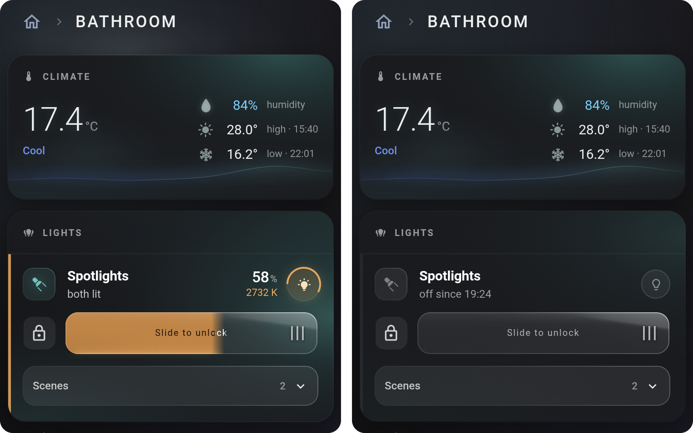

# Room header

`lamplight-header`

This goes at the top of a room's page. It has the room's name, a way back home, and a soft glow when
a lamp in the room is on.

[← Back to the README](../../README.md)

<p align="center">
  
</p>

## lamplight-header

### What it does

Shows the room's name in capitals, with a small home button to take you back. When a lamp in the
room is on, a soft silver glow appears behind the name, so you can see from the very top of the page
that something is lit.

### You need

- Nothing, really. Add your lights if you would like the glow.

### Quick start

```yaml
type: custom:lamplight-header
name: Living room
back:
  navigation_path: /lovelace/home
lights:
  - light.living_room
  - light.living_room_lamp
```

### More options

<details>
<summary>All the options</summary>

| Key | Default | What it does |
|---|---|---|
| `name` | required | The room's name |
| `back` | none | The home button: `{ navigation_path, icon, label }`. `icon` defaults to `mdi:home-outline`. `label` is read out by screen readers (default "Home"). Without `back`, there is no button |
| `lights` | none | The lights that make the glow. Each is a light, or `{ light, members }` for a light group |
| `hide_ha_title` | `false` | `true` hides Home Assistant's own view title at the top of the screen, which repeats the room name |

</details>

### Without the extras

Without `lights`, the header never glows. If you leave out `back`, the name starts at the left edge.

### Tips

- The glow is the same soft silver in every room. It only tells you that a lamp is on, not what
  color it is.
- Put each room on its own view (a subview works well), with the header as the first card.
