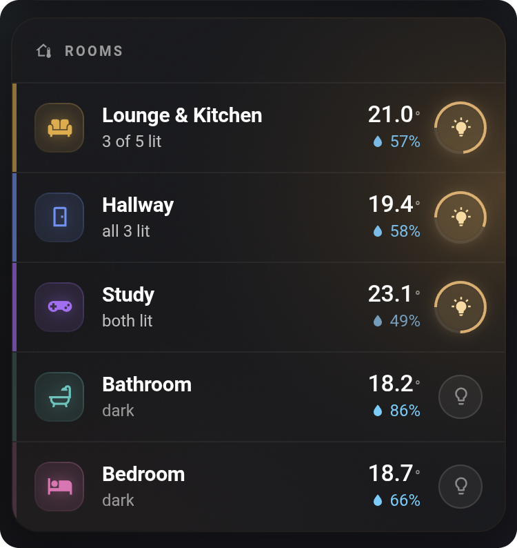
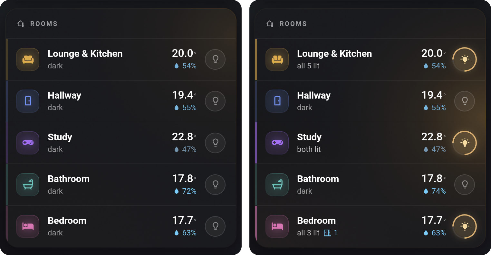

# Rooms

`lamplight-rooms`

Every room in your home on one card, which usually goes at the top of your main view. You can see
which rooms are lit, how warm they are, and whether a window is open.

[← Back to the README](../../README.md)

<p align="center">
  
</p>

## lamplight-rooms

### What it does

There is one row for each room, with its icon and name, how many lights are on, the temperature and
humidity, and a toggle for all of its lights. The panel's light gathers around the rooms that are
lit. Tap a row to go to the room's page.

This card is already a panel, so don't put it inside a `lamplight-panel`.

### What you'll see

On the left, each room's icon is on a small tile in the room's own color. The line under the name
counts the lights: "dark", "lit", "both lit", "2 of 3 lit" or "all 4 lit". The humidity has its own
color, which is paler when the air is dry and a deeper blue when it's damp.

This is the same card twice. The first is late at night with everything off. The second is in the
evening, with three rooms lit, a bedroom window open and a steamy bathroom:

<p align="center">
  
</p>

The toggle on the right works on the whole room. If anything in the room is on, a tap turns it all
off. If the room is dark, a tap turns everything on. You never end up with half the lights on and
half off.

### You need

- A light or a light group for each room.
- Optional: a temperature and a humidity sensor for each room.

### Quick start

Start with two rooms, and add the rest once those look right. This is the longest configuration in
Lamplight, so you don't want to have to type it all out twice.

```yaml
type: custom:lamplight-rooms
accent: marigold
heading:
  icon: mdi:home-outline
  label: Rooms
rooms:
  - name: Living room
    icon: mdi:sofa-outline
    accent: marigold
    light: light.living_room
    temperature: sensor.living_room_temperature
    humidity: sensor.living_room_humidity
    tap_action:
      action: navigate
      navigation_path: /lovelace/living-room
  - name: Bedroom
    icon: mdi:bed-outline
    accent: rose
    light: light.bedroom
    temperature: sensor.bedroom_temperature
    humidity: sensor.bedroom_humidity
    tap_action:
      action: navigate
      navigation_path: /lovelace/bedroom
```

### More options

<details>
<summary>All the options</summary>

| Key | Default | What it does |
|---|---|---|
| `accent` | required | The color of the panel's light |
| `rooms` | required | The rooms, top to bottom. See the next table |
| `heading` | none | A small title at the top: `{ icon, label }` |
| `humidity_range` | `[45, 65]` | The dry and damp ends of the humidity color |
| `humidity_colors` | three blues | The humidity color: dry, middle, damp |
| `side_bar_opacity` | `[0.22, 0.60]` | The thin bar on the left of each row, when the room is dark and when it is lit. `false` hides it |
| `toggle_color`, `toggle_icon_color_on` | warm white | The lit toggle and its icon |
| `words` | built in | The words on the lights line |
| `entities` | the rooms' lights | What moves the light. You rarely need this |

Plus all the panel keys, such as `light_style` and `theme`. See [The panel](panel.md#more-options).

Each room:

| Key | Default | What it does |
|---|---|---|
| `name` | required | Your word for the room |
| `light` | required | The room's light or light group |
| `icon` | required | The room's icon |
| `accent` | required | The room's color |
| `extra_lights` | none | More lights that are not in the group. They count too |
| `temperature`, `humidity` | none | The room's sensors. Without them, the row shows "--" |
| `tap_action` | none | What a tap does. Without it, the row doesn't respond to a tap |
| `chips` | none | Small counters on the lights line. See the example below |
| `chip_color`, `glow_color`, `side_bar_color` | the room's accent | Fine-tune the room's colors |

</details>

### Example: show open windows on the room's row

A chip counts how many of its entities are on, and hides when the count is zero. It's one of the
places where you'll see an open window. The others are on the
[Windows](windows.md#one-open-window-everywhere-it-matters) page.

```yaml
rooms:
  - name: Bedroom
    icon: mdi:bed-outline
    accent: rose
    light: light.bedroom
    chips:
      - entities:
          - binary_sensor.bedroom_window
        icon: mdi:window-open-variant
        color: window-open
```

If you don't set a `color`, the chip is orange, which means "needs a look".

### Tips

- Use the same color for a room everywhere, meaning here, on its light rows and on its climate row.

