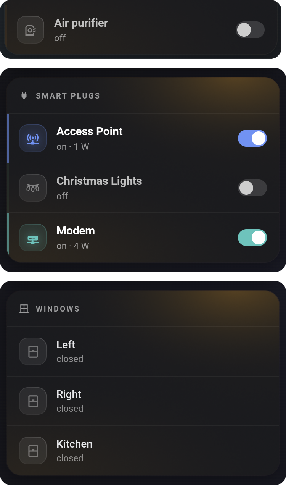
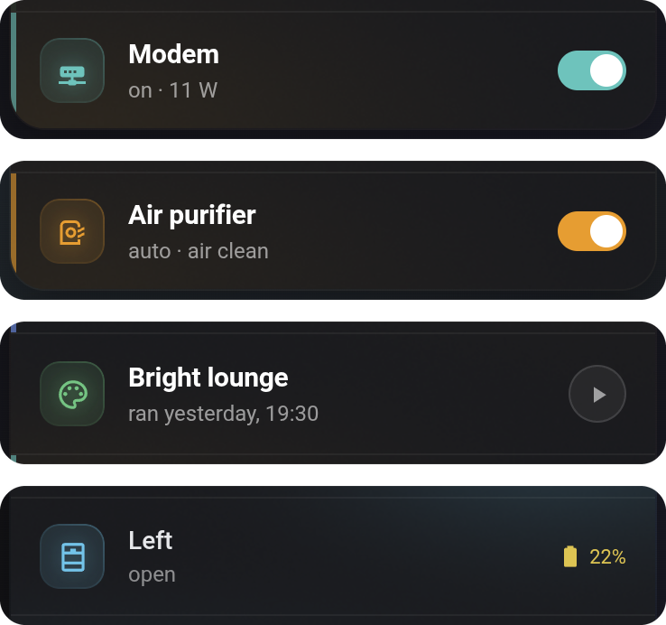

# Rows

`lamplight-row`

A row for the things in a room that aren't lights, such as a plug, a fan, a script or a window
sensor. Each row shows what the thing is doing and gives you one control.

[← Back to the README](../../README.md)

<p align="center">
  
</p>

## lamplight-row

### What it does

A simple row with an icon, a name, a short status line and one control on the right. There are four
kinds:

| Kind | For | On the right |
|---|---|---|
| `toggle` | A switch or a plug | A toggle. With a power sensor, it shows the watts |
| `fan` | A fan or an air purifier | A toggle, with the mode and the air quality |
| `run` | A script or a scene | A play button |
| `contact` | A door or window sensor (read only) | Its state, and a battery mark when the battery is low |

Below is one of each. From the top, they are a plug using 11 W, an air purifier on auto, a scene
that ran yesterday evening, and an open window whose sensor battery is getting low. A window row is
only one of the cards that change when a window opens. You can follow one open window across all of
them on the [Windows](windows.md#one-open-window-everywhere-it-matters) page.

<p align="center">
  
</p>

### You need

- The entity for the row.

### Quick start

```yaml
type: custom:lamplight-panel
accent: cornflower
light_style: accent
heading:
  icon: mdi:power-socket-uk
  label: Plugs
cards:
  - type: custom:lamplight-row
    kind: toggle
    entity: switch.coffee_machine
    accent: cornflower
    power_sensor: sensor.coffee_machine_power
  - type: custom:lamplight-row
    kind: toggle
    entity: switch.router
    accent: cornflower
    confirm_off: true
```

### More options

<details>
<summary>All the options</summary>

Every kind:

| Key | Default | What it does |
|---|---|---|
| `kind` | required | `toggle`, `fan`, `run` or `contact` |
| `entity` | required | The entity |
| `accent` | required | The color of the icon tile |
| `name`, `icon` | from the entity | Your own words and icon |
| `tap_action` | open its details (`run`: nothing) | What a tap on the row does |

`toggle` and `fan`:

| Key | Default | What it does |
|---|---|---|
| `power_sensor` | none | A power sensor. The row shows the watts while it's on |
| `confirm_off` | none | `true` asks before turning off. Or `{ title, text, confirm, dismiss }` for your own words |
| `side_bar_opacity` | `[0.08, 0.60]` | The thin left bar when off and when on |

`fan` only:

| Key | Default | What it does |
|---|---|---|
| `air_sensor` | none | A PM2.5 sensor. The row shows the air quality in words |
| `air_quality_limits` | `[12, 35, 55]` | Where each word starts |
| `air_quality_labels` | clean, fair, poor, very poor | The words |
| `filters` | none | `{ entity, name, job }` for each filter. `job` is `clean` or `replace` |
| `filter_alert_level` | `20` | At or below this %, the row says "replace the filter" |

`contact` only:

| Key | Default | What it does |
|---|---|---|
| `icon_on` | `icon` | The icon when the sensor is on (open) |
| `icon_unknown` | a question mark | The icon when the state is unknown |
| `battery_sensor` | none | The sensor's battery. A mark shows at 39% or less |

</details>

### Tips

- Use `confirm_off` on anything you would regret switching off by accident, like the router. You
  won't be asked when you turn it back on.
- A `run` row on a scene shows when the scene was last used.
- Some rows have a popup of their own. There is a plug row with its popup on [Smart
  plugs](smart-plugs.md), and an air purifier on [Popups](popups.md#lamplight-purifier-detail). For
  the window rows, see [Windows](windows.md).
