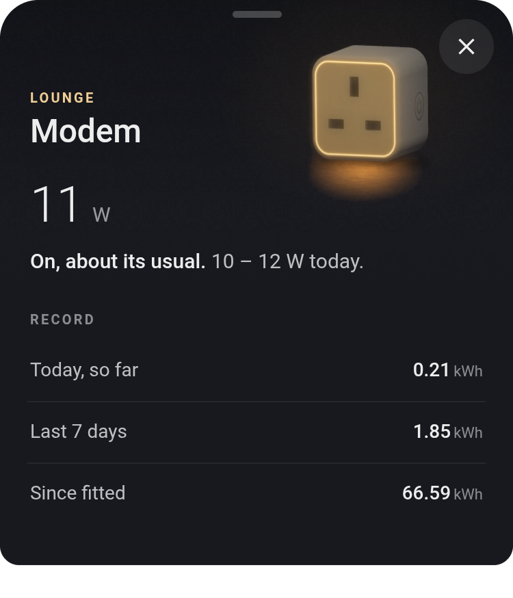
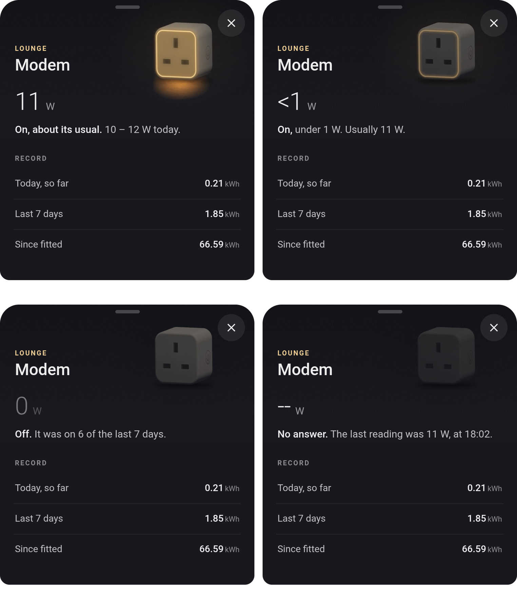
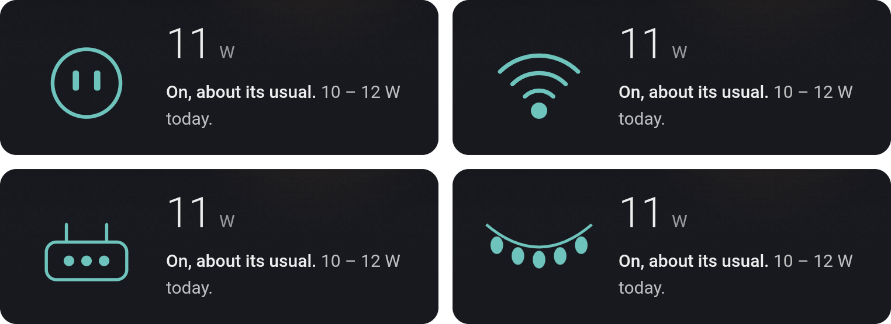
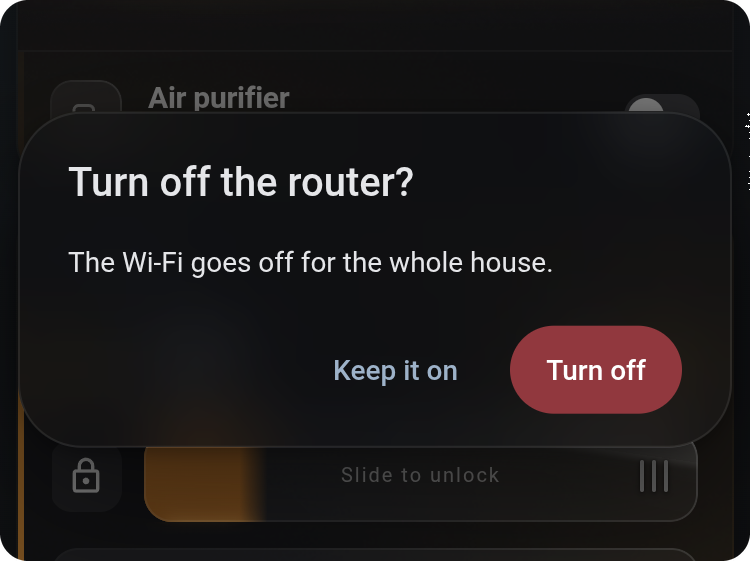

# Smart plugs

`lamplight-plug-detail`, with the plug rows from [`lamplight-row`](rows.md#lamplight-row)

A row for each plug in the room, with a popup that tells you what the device is doing right now and
whether that's normal for it.

[← Back to the README](../../README.md)

<p align="center">
  
</p>

## Putting it together

Each plug has a [`lamplight-row`](rows.md#lamplight-row) in a panel, and a popup. The row's
`navigation_path` and the popup's `hash` need to be the same. Tap the row to open its popup.

```yaml
- type: custom:lamplight-panel
  accent: cornflower
  light_style: accent
  heading:
    icon: mdi:power-socket-uk
    label: Plugs
  cards:
    - type: custom:lamplight-row
      kind: toggle
      entity: switch.coffee_machine
      accent: cornflower
      power_sensor: sensor.coffee_machine_power
      tap_action:
        action: navigate
        navigation_path: '#coffee-machine'
- type: custom:lamplight-popup
  hash: '#coffee-machine'
  title: Coffee machine
  icon: 'lamp:socket'
  accent: cornflower
  header_art: live
  cards:
    - type: custom:lamplight-plug-detail
      entity: switch.coffee_machine
      power_sensor: sensor.coffee_machine_power
      energy_sensor: sensor.coffee_machine_energy
      accent: cornflower
```

## lamplight-plug-detail

### What it does

This goes inside a smart plug's popup. The power right now is in big numbers. Below it, a short
sentence tells you whether the device is using about what it usually does. After that come today so
far, the last seven days, and the total since the plug was fitted.

### What you'll see

With `header_art: live`, there is a smart plug at the top of the popup that lights up to match the
device. The sentence under the number tells you the same thing in words.

| State | The plug at the top | The sentence, for example |
|---|---|---|
| In use | Glowing amber, with a warm pool of light under it | "On, about its usual. 10 – 12 W today." |
| Idle | Just a thin amber ring | "On, under 1 W. Usually 11 W." |
| Off | Dark | "Off. It was on 6 of the last 7 days." |
| No answer | Faded | "No answer. The last reading was 11 W, at 18:02." |

<p align="center">
  
</p>

Idle means that the plug is on, but the device is using next to nothing when it normally uses more.
The "normally" matters because some devices always use very little power. A Wi-Fi access point might
never go above 1 W, so for that one, under 1 W still counts as in use.

If a device is using a lot more or a lot less than it normally does, the sentence will say so, for
example: "On, above its usual. Usually 11 W."

### The plug at the top, and the drawing beside the number

A plug popup can have two pictures. One is the painted plug at the top, which you get with
`header_art: live` on the popup. The other is a small drawing of the device beside the number, and
you choose it with `device_icon`. You can use both, or only one of them.

| You want | Set |
|---|---|
| Both pictures | `header_art: live` on the popup. This is what the example at the top does |
| Only the painted plug | `header_art: live` on the popup, and `icon_in_header: true` on the plug card |
| Only a drawing, up at the top | Leave out `header_art`, set `icon_in_header: true`, and pick the drawing with the popup's `icon`, such as `lamp:access-point` |

In the last of these, the drawing at the top comes from the popup's `icon` and not from
`device_icon`. It still lights up with the device.

`device_icon` has four drawings: `plug`, `access-point`, `modem` and `string-lights`. Parts of them
light up while the device is using power.

<p align="center">
  
</p>

### You need

- A smart plug. Home Assistant shows it as a `switch` entity, such as `switch.coffee_machine`.
- Optional: the plug's own power sensor (watts) and energy sensor (kWh). You don't need a separate
  meter. A plug that measures its energy use has both of them as extra entities on the same device,
  such as `sensor.coffee_machine_power`.
- Home Assistant's long-term statistics for the power sensor, for "the last seven days" and "usual".

> [!IMPORTANT]
> Home Assistant only keeps long-term statistics for a power sensor that has a `state_class` of
> `measurement`. Without them the popup never says "usual", and you won't see "Today, so far" and
> "Last 7 days".

### Quick start

See [Putting it together](#putting-it-together).

### More options

<details>
<summary>All the options</summary>

| Key | Default | What it does |
|---|---|---|
| `entity` | required | The plug's switch |
| `power_sensor` | none | The power now, in watts |
| `energy_sensor` | none | The total energy, in kWh, for "since fitted" |
| `accent` | `90,150,245` | The plug's color. Use the color of its row |
| `device_icon` | `plug` | The drawing beside the number: `plug`, `access-point`, `modem` or `string-lights`. Hidden when `icon_in_header` is `true` |
| `icon_in_header` | `false` | `true` hides the drawing beside the number. Without `header_art`, the popup's `icon` at the top lights up with the device instead. With `header_art: live`, the painted plug stays at the top. See [the two pictures](#the-plug-at-the-top-and-the-drawing-beside-the-number) |
| `active_watts` | `1` | The watts at which the device counts as in use |
| `usual_tolerance` | `0.2` | How far from the weekly average still counts as "about its usual" (0.2 is 20%) |
| `power_graph`, `usage_graph` | none | Any card for the foot of the sheet. See [Companion cards](../companions.md#mini-graph-card-graphs-in-the-popups) |

</details>

### Without the extras

Without `power_sensor`, the number shows "--", the drawing follows the switch, and there is no
"usual" sentence. Without `energy_sensor`, there is no "since fitted" total. Until Home Assistant
has some history for the plug, all the sentence says is "On and drawing."

## Ask before turning off

There are some things you really don't want to switch off by accident, like the router. Add
`confirm_off: true` to the row, and a tap on its toggle will ask first. You won't be asked when you
turn it back on.

```yaml
- type: custom:lamplight-row
  kind: toggle
  entity: switch.router
  accent: cornflower
  confirm_off:
    title: Turn off the router?
    text: The Wi-Fi goes off for the whole house.
```

<p align="center">
  
</p>

The safe answer is the easy one. "Keep it on" is already selected, and it also stays on if you tap
outside the box or use your phone's back gesture.

## Tips

- The amber glow is the same in every room, so a plug that is on always looks the same. The row and
  the popup header still use your `accent`.
