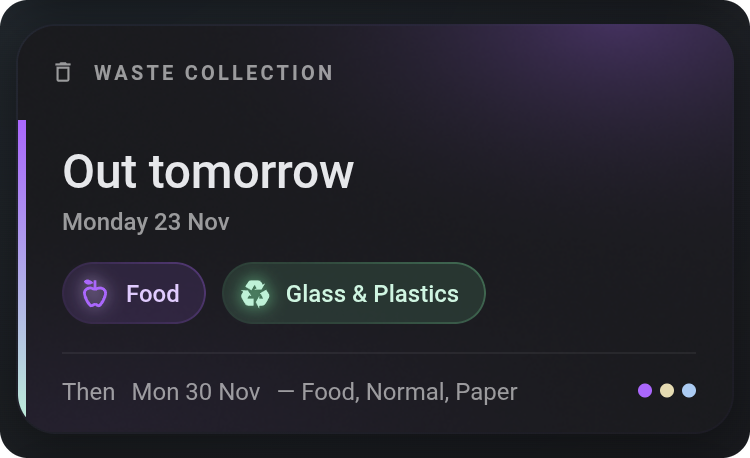
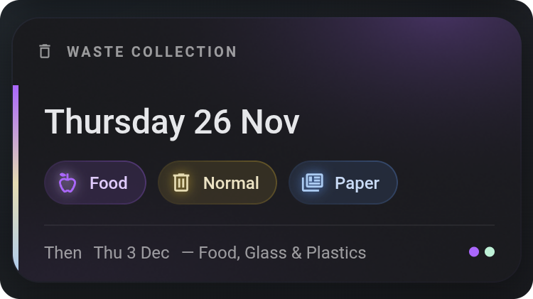

# Waste

`lamplight-waste`

This card shows which bin goes out next, and when. The whole panel takes that bin's color, so you
know which one it is before you have read anything.

[← Back to the README](../../README.md)

<p align="center">
  
</p>

## What it does

A panel that shows the next collection, with the bin, the day and a countdown. It stands out more on
the evening before, because that's when you actually need to remember. A second line tells you which
bin comes after that ("Then …"). If more than one bin goes out on the same day, all of them are
shown.

Earlier in the week it only names the day. In the picture below, three bins go out together on the
Thursday, and the line underneath has the next collection after that.

<p align="center">
  
</p>

The card checks the date again just after midnight, so "tomorrow" doesn't stay there a day too long.

## You need

- The [Waste Collection Schedule](https://github.com/mampfes/hacs_waste_collection_schedule)
  integration, with one sensor for each bin.

> [!IMPORTANT]
> For now this card can only read Waste Collection Schedule sensors. Other waste integrations won't
> work yet. The settings that matter are in [Setting up the sensors](#setting-up-the-sensors).

## Setting up the sensors

The card reads each upcoming collection from the sensor's attributes. Waste Collection Schedule
lists them there by date, for example `2026-12-04: Food Waste`. It does this by default, so you
probably won't need to change anything. It's still worth checking the settings of each sensor,
whether you set it up in the UI or in YAML:

- Make one sensor for each bin, and use the Types filter so that it only shows the collections for
  that bin.
- Leave Details Format on upcoming, which is the default.
- Leave Date Template empty. If you set one, the dates change format and the card won't find them.

In YAML, a sensor for the food bin looks like this:

```yaml
waste_collection_schedule:
  sensors:
    - name: Food waste
      details_format: upcoming
      types:
        - Food Waste
```

Type the waste type exactly as your source names it. To check a sensor, open it in
**Developer tools > States**. There should be dates like `2026-12-04` among its attributes.

## Quick start

```yaml
type: custom:lamplight-waste
heading:
  icon: mdi:delete-outline
  label: Bins
light_from: top-edge
bins:
  - entity: sensor.waste_general
    label: General
    icon: mdi:trash-can-outline
    color: mustard
  - entity: sensor.waste_recycling
    label: Recycling
    icon: mdi:recycle
    color: bluebell
  - entity: sensor.waste_garden
    label: Garden
    icon: mdi:leaf
    color: pear
```

This card is already a panel, so don't put it inside a `lamplight-panel`.

## More options

<details>
<summary>All the options</summary>

| Key | Default | What it does |
|---|---|---|
| `bins` | required | One entry for each bin. See the next table. List them in the order that should win when two bins go out on the same day |
| `heading` | none | A small title at the top: `{ icon, label }` |
| `show_following_collection` | `true` | Show the "Then …" line for the collection after the next |
| `locale` | `en-GB` | The language and style of the dates |
| `idle_color` | `panel-rest` | The panel's color when no collection is coming up |
| `tap_action` | open the details of the next bin | What a tap does |
| `light_from` | `corner` | `top-edge` starts the light from the top |

Plus the other panel keys, such as `theme`. The waste panel always uses the steady `accent` light,
so it has no `light_style`.

Each bin:

| Key | Default | What it does |
|---|---|---|
| `entity` | required | The bin's Waste Collection Schedule sensor |
| `label` | required | Your word for the bin |
| `icon` | required | The bin's icon |
| `color` | required | A [palette name](../styling.md#colors-by-name) |

</details>

## Without the extras

With `show_following_collection: false`, the card only shows the next collection. If there is no
collection coming up, the panel is a quiet blue-grey.

## Tips

- Four of the palette colors are made for bins: `grape` (food), `mustard` (general), `bluebell`
  (paper) and `mint` (glass and plastics). You can use any other palette name too.
- Use whatever your household calls the bins. "Black bin" or "Food caddy" tells you more than the
  name on the council's website.
