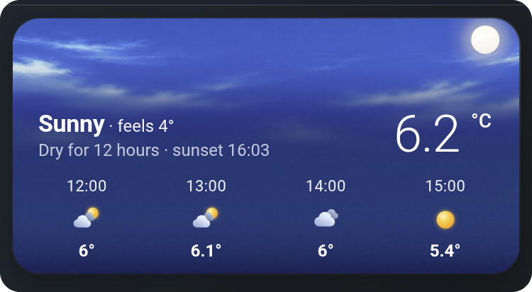
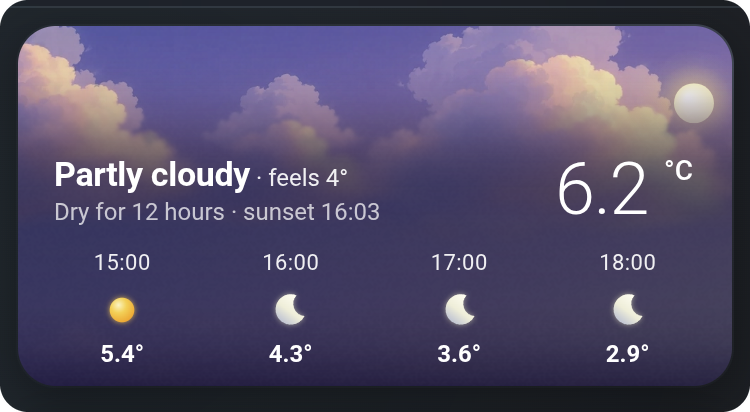
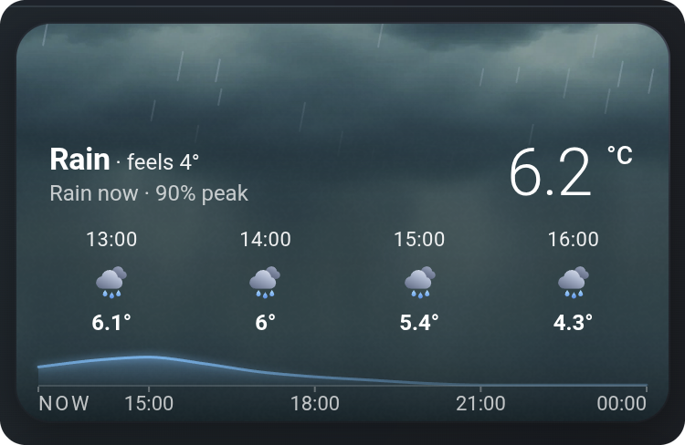
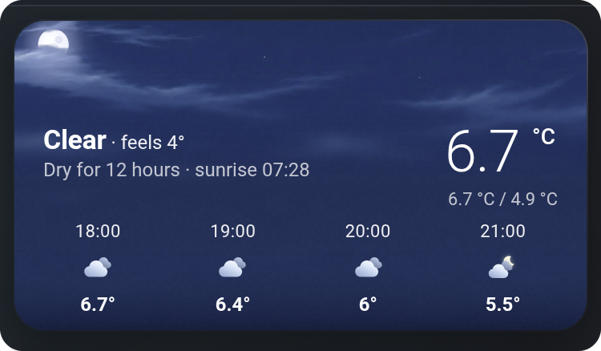
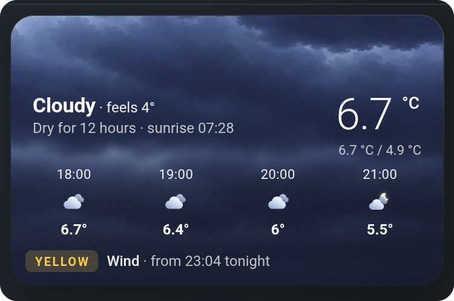
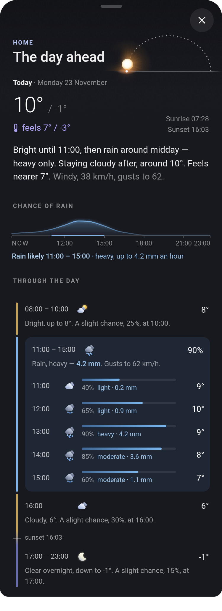
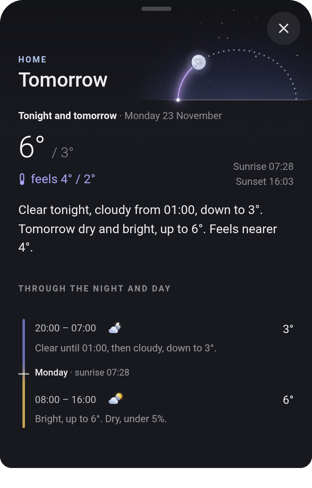

# Weather

`lamplight-weather` · `lamplight-day`

A weather card with a painted sky that changes with the weather and the sun. It has a Today popup
that shows you the whole day.

[← Back to the README](../../README.md)

<p align="center">
  
  
  
  
</p>

## lamplight-weather

### What it does

The top of the card is a sky. It shows the weather now (clear, cloudy, rain, snow, fog and more) in
the light of the time of day. Noon is bright, sunset is golden, twilight is deep blue and a clear
night has stars. They blend smoothly into each other as the sun moves.

Below the sky you'll find:

- The temperature and the weather now, in plain words. The feels-like temperature is added when it's
  2 degrees or more away from the real one.
- The next four hours, each with a temperature and a weather picture. Lamplight draws its own
  weather pictures so that they match the rest of the cards.
- One line about the hours ahead. It answers "will it rain?" first, for example "Dry until 15:00 ·
  rain, 60%". On a dry day it tells you the next most useful thing instead, which could be a strong
  wind, a high UV level, how cold it feels or when the sun sets.
- A rain chart, once the chance of rain reaches 40% in the next 12 hours.
- Any weather warning, in the color of its level.

### You need

- A weather entity with an hourly forecast. Most weather integrations have one.
- Optional: warning sensors, and wind gust, feels-like and UV sensors. See
  [Weather sensors](../weather-sensors.md).

### Quick start

```yaml
type: custom:lamplight-weather
entity: weather.home
```

This card is already a panel, so don't put it inside a `lamplight-panel`.

### Open the Today popup with a tap

Normally a tap opens Home Assistant's own weather details. To open the Today popup instead, add a
`tap_action` and put a Today popup on the same view:

```yaml
- type: custom:lamplight-weather
  entity: weather.home
  tap_action:
    action: navigate
    navigation_path: '#today'
- type: custom:lamplight-popup
  hash: '#today'
  title: Today
  icon: 'lamp-arc:sun.sun'
  accent: honey
  cards:
    - type: custom:lamplight-day
      entity: weather.home
```

The `lamp-arc` icon draws the path of the sun across the day at the top of the popup.

### More options

<details>
<summary>All the options</summary>

| Key | Default | What it does |
|---|---|---|
| `entity` | required | The weather entity |
| `sun_entity` | `sun.sun` | The sun, for the sky's light, sunrise and sunset |
| `warning_sensor` | none | The weather warning. Without it, there is no warning strip |
| `warning_count_sensor` | none | How many warnings there are |
| `warning_start_sensor`, `warning_end_sensor` | none | When the warning starts and ends |
| `gust_sensor` | none | Wind gusts. Without it, the card uses the weather entity's own gust speed |
| `feels_like_sensor` | none | The feels-like temperature |
| `uv_sensor` | none | The UV index |
| `outlook_hours` | `12` | How far ahead the rain line and the rain chart look, in hours |
| `rain_ribbon_threshold` | `40` | The chance of rain, in %, that shows the rain chart |
| `forecast_slots` | `4` | How many hours to show |
| `forecast_type` | `hourly` | The forecast to read |
| `sky_style` | `plates` | `plates` (painted pictures), `painted` (drawn by the card) or `classic` (a plain gradient) |
| `plate_folder`, `mask_folder` | in `lamplight-sky/` | Where the sky pictures are, if you move them |
| `hide_ha_title` | `false` | `true` hides Home Assistant's own view title |
| `smooth_gradient` | `true` | A fine grain that hides color bands |
| `tap_action` | open the weather details | What a tap does |

See the [Weather sensors](../weather-sensors.md) page for the sensors and their formats.

<p align="center">
  
  
</p>

</details>

### Without the extras

| Without | You see |
|---|---|
| `warning_sensor` | No warning strip |
| `warning_start_sensor`, `warning_end_sensor` | The warning, without its times |
| `gust_sensor` | The gust from the weather entity, if it has one |
| `feels_like_sensor` | No feels-like temperature |
| `uv_sensor` | No UV line |
| The `lamplight-sky/` folder | The card draws its own sky (`painted`) |

### About the sky pictures

To be upfront about it: the painted sky pictures were made with an AI image generator (ChatGPT) and
then cut to size. There are 28 of them, for seven kinds of weather in four different lights. If
you'd prefer not to use them, set `sky_style: painted` and the card will draw the sky itself.

## lamplight-day

### What it does

This is the body of the Today popup. From top to bottom, it shows:

- The day and date, with today's high and low.
- One sentence about the day, such as "Brightening through the afternoon".
- Sunrise and sunset.
- The day in parts: this morning, this afternoon, this evening and overnight, each with its weather.
- One timeline of the hours ahead, with rain marked.
- The weather warning, with when it starts and how long it lasts.

It's most useful on a busy day. The one below has a cold start, then heavy rain and strong gusts
through the middle of the day, a short dry spell, and a frosty clear night. The rain has its own
chart and an hour-by-hour breakdown, so you can see exactly when to go out.

<p align="center">
  
</p>

After dark, the popup looks ahead to tomorrow. The moon takes the sun's place on the arc. The
timeline starts with the night, showing how cold it gets and whether it stays clear, and then goes
on to the next day.

<p align="center">
  
</p>

### You need

- The same weather entity as the weather card.
- Optional: the same warning sensors.

### Quick start

See [Open the Today popup with a tap](#open-the-today-popup-with-a-tap).

### More options

<details>
<summary>All the options</summary>

| Key | Default | What it does |
|---|---|---|
| `entity` | required | The weather entity |
| `sun_entity` | `sun.sun` | The sun, for sunrise and sunset |
| `warning_sensor`, `warning_count_sensor` | none | The weather warning and how many there are |
| `warning_start_sensor`, `warning_end_sensor` | none | When the warning starts and ends. With both, the timeline marks the hours it covers |
| `forecast_type` | `hourly` | The forecast to read |

</details>

### Without the extras

There is no warning block without `warning_sensor`. Without the start and end sensors, the warning
is shown without its times.

### A title that changes through the day

A fixed title like "Today" looks odd in the evening, when the popup is already talking about
tomorrow. A popup's `title` can be a template, so it can change with the time:

```yaml
- type: custom:lamplight-popup
  hash: '#today'
  title: >-
    {{ 'The day ahead' if now().hour < 13
       else ('Tomorrow' if now().hour >= 19 or is_state('sun.sun', 'below_horizon')
       else 'Later today') }}
  icon: 'lamp-arc:sun.sun'
  accent: honey
  cards:
    - type: custom:lamplight-day
      entity: weather.home
```

The title will be "The day ahead" in the morning and "Later today" in the afternoon. From 7 in the
evening, or once the sun has set, it's "Tomorrow", because by then the popup is looking ahead to the
next day anyway. Home Assistant updates the title as the day goes on, so you don't have to refresh
anything.

### Tips

- Give the weather card and the Today popup the same sensors so that they never disagree.
- Forecasts change during the day, and the popup updates when yours does.
