# Windows

`lamplight-window-strip` · `lamplight-windows-detail`

A small panel for the foot of your main view, and popups with the details. They tell you whether a
window is open and what the weather is like outside.

[← Back to the README](../../README.md)

<p align="center">
  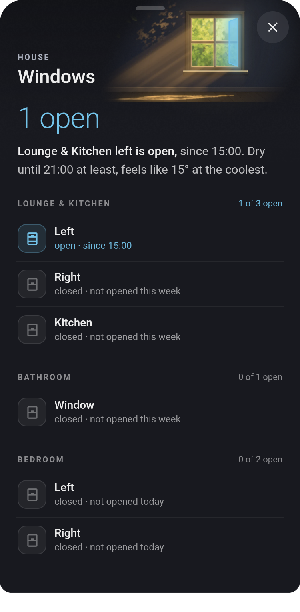
</p>

## One open window, everywhere it matters

When you open a window, every card that knows about it changes. The pictures below are of the
bedroom's left window, 35 minutes after someone opened it on a cold morning. In order:

1. On the [rooms card](rooms.md), the bedroom row counts it with a small blue window.
2. In the bedroom's Windows panel, the window's [row](rows.md) turns blue and says "open".
3. In the bedroom's windows popup, the window is open in the picture, with a soft blue light in the
   gap. The popup says "1 open", since when and how cold it feels.
4. On the main view, the window strip lights up blue, says "1 open" and names the window. A small
   pill warns you about the cold as well.
5. The whole-home popup names the window in its first line, with the same warning.

<p align="center">
  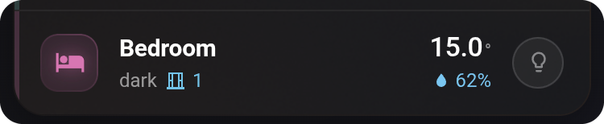
  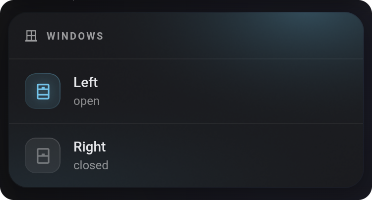
  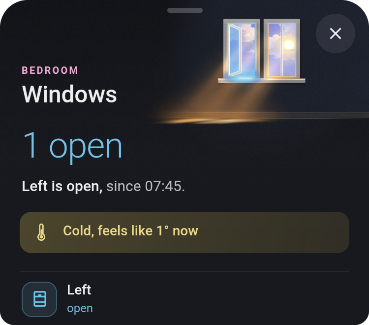
  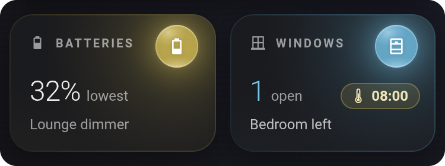
  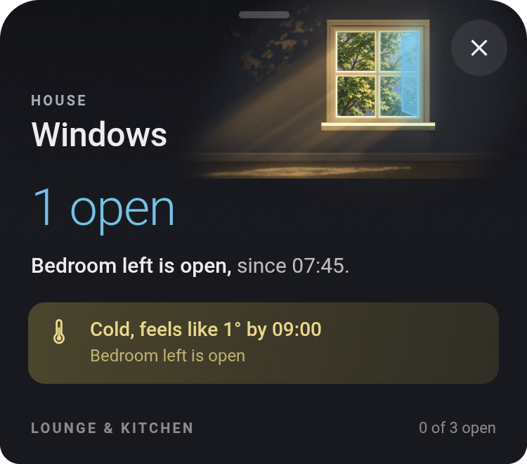
</p>

All five go quiet again when you close the window.

> [!IMPORTANT]
> Each of these cards has its own list of windows. When you add a window sensor, add it to every
> card that should know about it. If you miss one, that card won't show the window, and you won't
> get a warning.

## Putting it together

The window strip opens a popup called `#windows`, so put this popup on the same view. In this
example it's beside the [battery strip](batteries.md), in a
[`lamplight-strips`](panel.md#lamplight-strips) card:

<details>
<summary>Show the YAML (36 lines)</summary>

```yaml
- type: custom:lamplight-strips
  cards:
    - type: custom:lamplight-battery-strip
    - type: custom:lamplight-window-strip
      weather: weather.home
      rooms:
        - name: Bedroom
          windows:
            - entity: binary_sensor.bedroom_window
        - name: Kitchen
          windows:
            - entity: binary_sensor.kitchen_window
- type: custom:lamplight-popup
  hash: '#batteries'
  title: Batteries
  icon: 'lamp:battery'
  accent: '78,200,130'
  header_art: live
  cards:
    - type: custom:lamplight-batteries
- type: custom:lamplight-popup
  hash: '#windows'
  title: Windows
  icon: 'lamp:window'
  accent: window-open
  header_art: live
  cards:
    - type: custom:lamplight-windows-detail
      weather: weather.home
      rooms:
        - name: Bedroom
          windows:
            - entity: binary_sensor.bedroom_window
        - name: Kitchen
          windows:
            - entity: binary_sensor.kitchen_window
```

</details>

If you only want windows, leave out the battery strip and its popup.

## lamplight-window-strip

### What it does

Another small panel, this one with a window drawn in the corner. It shows how many windows are open
("2 open") and which ones. Open one and the right-hand side of the drawing swings out while the
light turns sky blue. When they're all closed it tells you about the day instead: "None opened
today", or the time the last window was closed.

Give it a weather entity and a small round pill with an icon shows up next to the number when a
window is open and rain, cold or a weather warning is on the way. Tap the strip to open `#windows`.

<p align="center">
  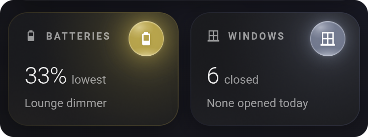
</p>

### You need

- A contact sensor for each window.
- Optional: a weather entity, for the weather pill.

### Quick start

```yaml
type: custom:lamplight-window-strip
rooms:
  - name: Bedroom
    windows:
      - entity: binary_sensor.bedroom_window
  - name: Study
    windows:
      - entity: binary_sensor.study_window
```

### More options

<details>
<summary>All the options</summary>

| Key | Default | What it does |
|---|---|---|
| `rooms` | required | The rooms and their windows: `{ name, windows: [{ entity, name }] }` |
| `weather` | none | A weather entity with an hourly forecast, for the pill |
| `warning_sensor`, `warning_count_sensor` | none | Weather warning sensors. See [Weather sensors](../weather-sensors.md) |
| `outlook_hours` | `6` | How many hours ahead to look for bad weather |
| `cold_below` | `12` | It counts as cold when it feels this cold or colder (°C) |
| `rain_above` | `40` | It counts as rain when the chance is this high or higher (%) |
| `tap_action` | open `#windows` | What a tap does |

</details>

### Without the extras

Without `weather`, there is no pill. If you leave out a window's `name`, the sensor's name is used.

## lamplight-windows-detail

### What it does

This is the body of a windows popup. There are two kinds, one for a single room and one for the
whole home. They look alike but they answer different questions, so they're explained separately
below.

### For a single room

Give it the room's `windows` and it tells you whether a window is open, and since when. An open
window moves to the top of the list. Below that, "How it's been" looks back over the week. It shows
whether a window was open after dark, how long one has been open today, and how long a window is
usually open on a day when you open one.

It also looks out for a window that was left open after dark, or that has been open longer than
usual. The "Worth a look" section only appears when something needs your attention.

<p align="center">
  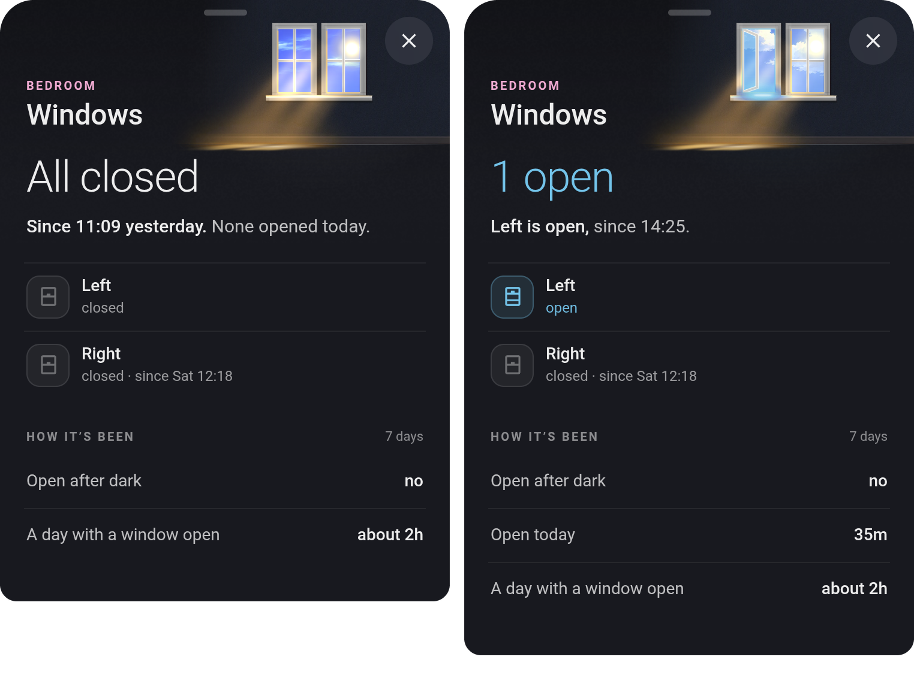
</p>

This is the bedroom popup after dark, four times. At the top left, everything is closed. At the top
right, one window is open on a mild evening, so there is nothing to add. At the bottom left it's the
same window with a cold night on the way, and at the bottom right, the same window during an amber
wind warning.

<p align="center">
  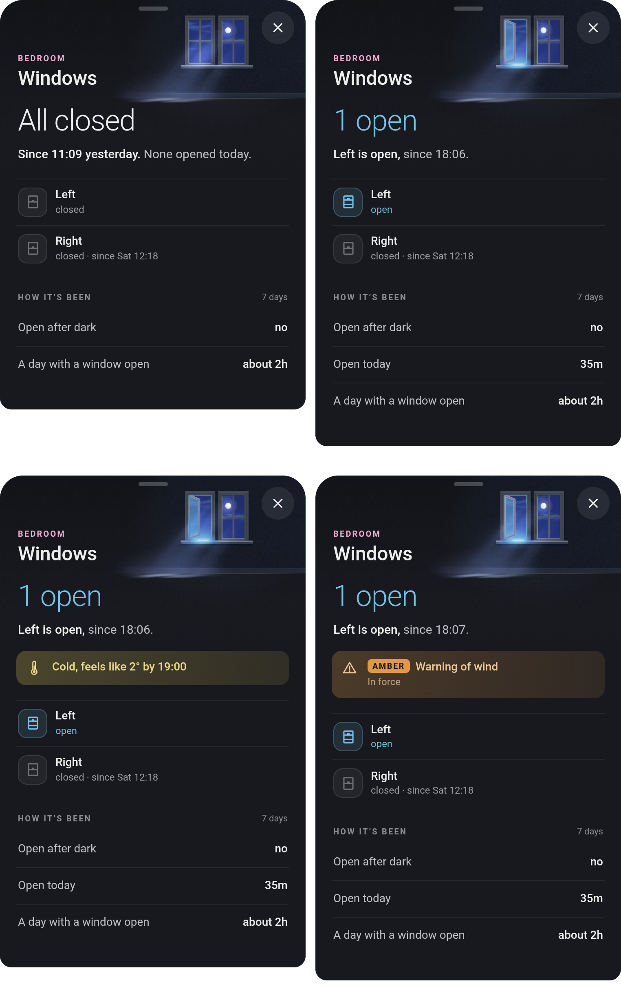
</p>

### For the whole home

Give it `rooms` and it lists every window, grouped by room, with how many are open in each. When
they are all closed, it tells you about the day, for example "None opened today". When a window is
open, the first line names it. If the weather is good, it adds how long it will stay dry.

<p align="center">
  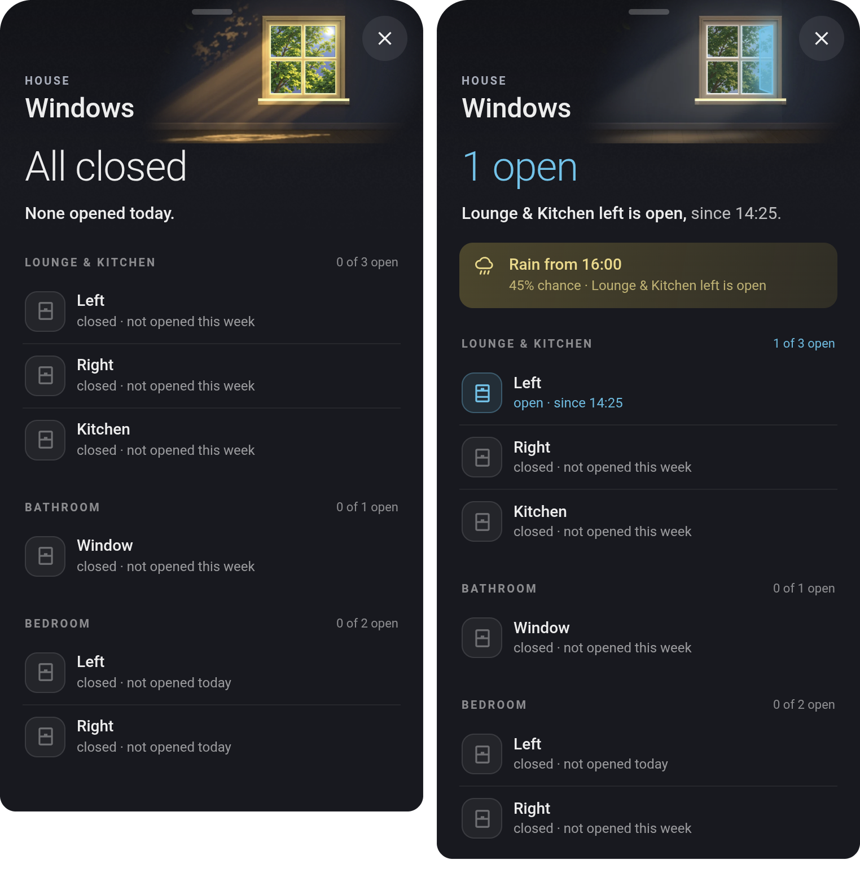
</p>

These are the same four evening states for the whole home:

<p align="center">
  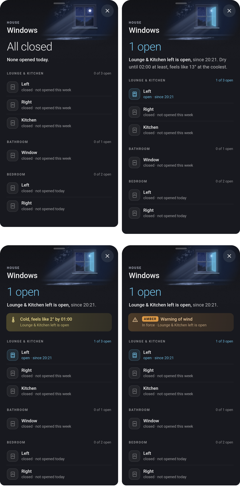
</p>

### The weather in the window popups

The window popups show you the weather outside, and they are one of the best parts of Lamplight.

The picture at the top has the light from outside. On the whole-home popup, sunlight falls into the
room at the sun's real height and turns golden near sunset. At night there is moonlight, with the
actual moon phase for that night.

<p align="center">
  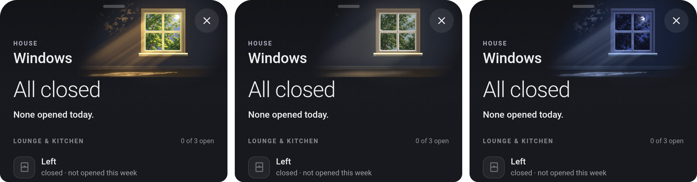
</p>

On a room's popup you look out through the window panes at the sky. When it's clear, or there are
only a few clouds, you can see the sun. Its light comes down through the window onto the floor. After
dark the moon takes over, in its real phase, and the light turns a pale blue. Under cloud or fog
there's no sun or moon, and the light goes soft and grey.

An open window swings outwards in the picture, and a soft blue light fills the gap. That way you can
tell which one it is, by day or by night.

<p align="center">
  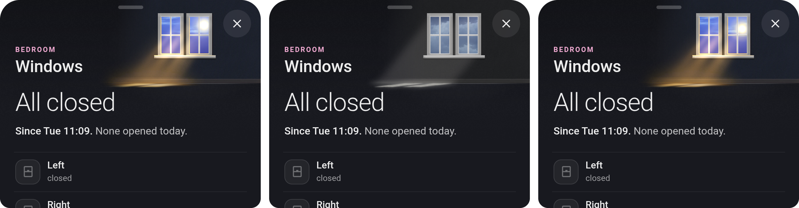
</p>

If a window is open while the next few hours look bad (rain, snow, cold or a weather warning), a
weather band appears, as in the pictures above. It's a gentle nudge to close the window.

### You need

- A contact sensor for each window.
- Optional: a weather entity, for the band.
- Home Assistant's history, for "since when", "after dark" and "longer than usual".

### Quick start

For one room:

```yaml
type: custom:lamplight-popup
hash: '#bedroom-windows'
title: Bedroom
heading: Windows
icon: 'lamp:window'
accent: window-open
header_art: live
cards:
  - type: custom:lamplight-windows-detail
    weather: weather.home
    windows:
      - entity: binary_sensor.bedroom_window
```

For the whole home, see [Putting it together](#putting-it-together).

### More options

<details>
<summary>All the options</summary>

| Key | Default | What it does |
|---|---|---|
| `windows` | required for one room | The room's windows: `{ entity, name, battery_sensor }` for each |
| `rooms` | required for the whole home | `{ name, windows: [{ entity, name, long_name, battery_sensor }] }`. `long_name` is the name in a sentence, for example "bedroom left" |
| `weather` | none | A weather entity with an hourly forecast, for the band |
| `warning_sensor`, `warning_count_sensor` | none | Weather warning sensors. See [Weather sensors](../weather-sensors.md) |
| `outlook_hours` | `6` | How many hours ahead to look |
| `cold_below` | `12` | Cold, in °C, as it feels |
| `rain_above` | `40` | Rain, as a chance in % |
| `sun_entity` | `sun.sun` | The sun, for "after dark" (one room only) |
| `history_days` | `7` | The days to look back over, today included (one room only) |
| `accent` | `window-open` | The "open" color |

</details>

### Without the extras

Without `weather`, there is no band. To leave out "after dark", set `sun_entity: null`. A window's
battery only shows when it's at 39% or less.

### Tips

- "After dark" runs from sunset for 12 hours.
- If two windows are open together for an hour, that counts as one hour for the room and not two.
- The window pictures are in the `lamplight-windows/` folder. If it's missing, the popup draws its
  own.
