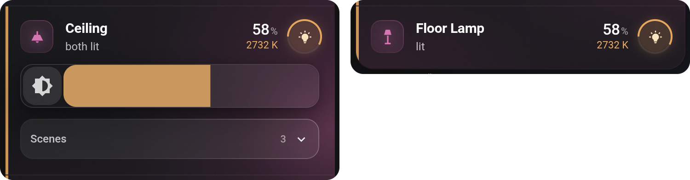
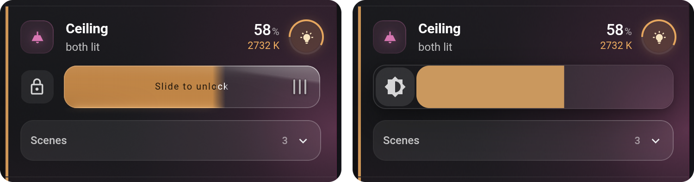

# Companion cards

Lamplight only needs Home Assistant. If you already use one of the cards below, though, it can be
used inside Lamplight. This page explains where each one goes, and what you get without it.

[← Back to the README](../README.md)

## At a glance

| Card | Where it plugs in | Without it |
|---|---|---|
| [Bubble Card](https://github.com/Clooos/Bubble-Card) | The brightness slider on a light row | The light row has no slider. Everything else works, including the on/off toggle. |
| [mini-graph-card](https://github.com/kalkih/mini-graph-card) | The graph at the foot of the climate and plug popups | The climate popup still draws its own 24-hour chart. The plug popup shows its readings in words. |
| [layout-card](https://github.com/thomasloven/lovelace-layout-card) | Not needed | Any single-column view works. |

> [!NOTE]
> You don't need Bubble Card for popups. Lamplight has its own popup card,
> [`lamplight-popup`](cards/popups.md).

## Bubble Card: the brightness slider

A Lamplight light row has a slot for a slider just under the light's name. Put a Bubble Card slider
in the `slider` key and it will fill with the light's real color.

<p align="center">
  
</p>

```yaml
type: custom:lamplight-light
light: light.living_room
accent: marigold
slider:
  type: custom:bubble-card
  card_type: button
  button_type: slider
  entity: light.living_room
  icon: mdi:brightness-6
  modules:
    - lamplight-slider
```

The `lamplight-slider` module makes the slider blend into the row. It clears the background, puts
the track beside the icon and fills it in the light's color. The file is in this repository at
[`companions/bubble-card/lamplight-slider.yaml`](../companions/bubble-card/lamplight-slider.yaml).
Add it to Bubble Card as a module, which is explained in Bubble Card's own documentation. The slider
works without `modules` too. It will just look like a regular Bubble Card slider.

### Two slider extras

It's easy to brush a slider with your thumb while you are scrolling the page. To prevent that, the
row ignores any touch on its slider for half a second after a scroll. You can change the time with
`scroll_guard_ms`, or set it to `0` to turn it off.

If that isn't enough, add `slider_lock: true`. This puts a clear glass cover over the slider until
you tap it or slide it to the left. It closes again after a few seconds, so a stray touch can't
change your lights.

<p align="center">
  
</p>

This is the "Slide to unlock" cover that you'll see in some of the pictures in these docs. It's off
unless you turn it on, so to begin with your slider will look like the one on the right.

### Without Bubble Card

Leave out the `slider` key. The row is a little shorter but keeps everything else: the name, how
many bulbs are lit, the brightness, the color and a working toggle. Tapping the icon opens Home
Assistant's own light controls.

## mini-graph-card: graphs in the popups

Two of the popup cards have a slot for a graph at the bottom. Any card can go there, but
mini-graph-card looks best.

In the climate popup (`lamplight-climate-detail`) it goes in the `graph` key:

```yaml
type: custom:lamplight-climate-detail
temperature: sensor.living_room_temperature
humidity: sensor.living_room_humidity
graph:
  type: custom:mini-graph-card
  entities:
    - sensor.living_room_temperature
  hours_to_show: 24
```

The [plug popup](cards/smart-plugs.md) (`lamplight-plug-detail`) has two slots, `power_graph` and `usage_graph`:

```yaml
type: custom:lamplight-plug-detail
entity: switch.coffee_machine
power_sensor: sensor.coffee_machine_power
power_graph:
  type: custom:mini-graph-card
  entities:
    - sensor.coffee_machine_power
  hours_to_show: 24
```

### Without mini-graph-card

You won't be left with a gap if you leave out the keys. The climate popup still draws its own chart
of the last 24 hours, and adds the outside temperature if you give it an `outside` sensor. The plug
popup still shows the power now, today's use, the last seven days and the total since the plug was
fitted.

## layout-card

layout-card is handy for a one-column view, but you don't need it. Lamplight works in any view,
though it looks best in a single column on a phone.

## Any other card

You can put any card in a Lamplight panel and it will take on the Lamplight look. See [Your other
cards fit in](how-it-works.md#your-other-cards-fit-in).
