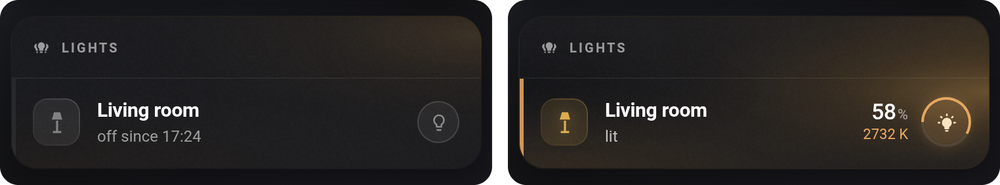

# Getting started

This page takes you from a fresh install to your first panel and your first popup. It should take
about ten minutes.

[← Back to the README](../README.md)

## What you need

You need Home Assistant 2026.9 or later and an administrator account, because only administrators
can install cards. If you are installing with the Marketplace you also need a GitHub account. Home
Assistant asks you to sign in to GitHub before it will add a repository from a link.

## Install

There are three ways to install Lamplight. If you have Home Assistant 2026.11 or later, use the
Marketplace. It's by far the easiest.

### With the Marketplace (Home Assistant 2026.11 and later)

1. Go to **Settings > Marketplace**.
   The first time you open it, Home Assistant shows a warning about community content. Read it and
   accept it.
2. Select **Add from link** in the top-right corner.
3. Enter `darrylms/lamplight-cards` and select **Add**.
   If Home Assistant asks for the type, choose **Dashboards** and select **Add** again.
4. Open **Lamplight Cards** and select **Install**. Check the version, then select **Install** again.
5. Reload your browser.

The Marketplace copies the cards and their pictures into `www/community/` and adds the dashboard
resource for you. There is nothing else to do.

> [!TIP]
> If you manage your dashboard resources in YAML, the Marketplace can't add the resource for you.
> Instead, the install dialog shows you the line to add to your YAML.

### With HACS (Home Assistant 2026.10 and earlier)

1. Open **HACS** and select the three dots in the top-right corner, then **Custom repositories**.
2. Enter `darrylms/lamplight-cards`, choose the type **Dashboard**, and select **Add**.
3. Find **Lamplight Cards**, select **Download**, then reload your browser.

### By hand

1. Download the files in the `dist/` folder of this repository.
2. Copy them into the `www/` folder of your Home Assistant configuration so that you have:

   ```
   www/
   ├── lamplight.js
   ├── panel-grain.png
   ├── lamplight-sky/       the weather card's sky pictures
   └── lamplight-windows/   the window popups' pictures
   ```

3. Go to **Settings > Dashboards**, select the three dots, then **Resources**.
4. Select **Add resource**. Enter `/local/lamplight.js?v=1` and choose **JavaScript module**.
5. Reload your browser.

When you update later, copy the new files over the old ones and increase the number at the end of
the resource, for example to `?v=2`. If you don't, your browser may keep using the old version.

> [!NOTE]
> The pictures are optional. If a folder is missing, the card that needs it draws its own picture
> instead.

## Check that it works

Edit a dashboard, select **Add card** and search for **Lamplight**. You should see all the cards
listed.

> [!NOTE]
> There is no visual editor yet. When you pick a Lamplight card, a starter configuration appears in
> the code editor and you can change it there. Every page in these docs has an example that you can
> copy.

If they aren't listed, open your browser's developer console. The cards print a small LAMPLIGHT
label with the version number when they load. If the label is missing then the resource isn't
loading, so check the path from step 4.

## Your first panel

A panel is the glowing background that holds your other cards. Edit a dashboard, add a **Manual**
card and paste in the text below. Remember to change `light.living_room` to one of your own lights.

```yaml
type: custom:lamplight-panel
accent: marigold
heading:
  icon: mdi:lightbulb-group
  label: Lights
entities:
  - light.living_room
cards:
  - type: custom:lamplight-light
    light: light.living_room
    accent: marigold
```

This is what each line does:

| Line | What it does |
|---|---|
| `type: custom:lamplight-panel` | The panel itself. |
| `accent: marigold` | The panel's color. Try `lagoon` or `rose`. All the names are in [Styling](styling.md). |
| `heading` | The small title at the top of the panel, with an icon. |
| `entities` | The things that move the light. When one is on, the light goes to its row. |
| `cards` | The cards inside the panel. Here, one light, in the same color as the panel. |

The light row takes its name and icon from your light. If your family calls it something else, add
`name:` and `icon:`:

```yaml
  - type: custom:lamplight-light
    light: light.living_room
    accent: marigold
    name: Reading lamp
    icon: mdi:floor-lamp
```

Now turn the light on and watch the panel. Then add a second light to both `entities` and `cards`.
When both are on, the panel gets noticeably brighter.

<p align="center">
  
</p>

To find out more about the three light styles and the color rules, see [How it
works](how-it-works.md).

## Your first popup

A popup is a sheet that slides up from the bottom of the screen. Each one has a name that starts
with `#`, called its hash. Any card can open a popup by going to its hash.

Add this card to a view. You won't see it until something opens it:

```yaml
type: custom:lamplight-popup
hash: '#batteries'
title: Batteries
icon: 'lamp:battery'
accent: '78,200,130'
header_art: live
cards:
  - type: custom:lamplight-batteries
```

Now you need something to open it with. The battery strip opens `#batteries` by itself:

```yaml
type: custom:lamplight-battery-strip
```

Tap the strip and the popup slides up, listing every battery in your home.

To open a popup from any other card, use a `navigate` tap action:

```yaml
tap_action:
  action: navigate
  navigation_path: '#batteries'
```

> [!IMPORTANT]
> The hash has to match exactly. Two cards open a popup without being told to: the battery strip
> opens `#batteries`, and the window strip opens `#windows`. If you use either of them, make the
> matching popup as well.

The [Popups](cards/popups.md) page has the rest.

## If something is wrong

| What you see | What to do |
|---|---|
| A red box that says a key is missing, for example "lamplight-row needs a kind" | Add the key it names. The error always says which one. |
| "Custom element doesn't exist" | The resource isn't loading. Reload the browser, then check the resource path. |
| A card works but a picture is missing | Check that the `lamplight-sky/` and `lamplight-windows/` folders sit beside `lamplight.js`. |
| You copied the files but still see the old version | Change the `?v=` number on the resource and reload. |
| You added a picture file later, but it still doesn't show | Home Assistant remembers a missing file for a long time. Change the `?v=` number and reload. |
| A tap does nothing | If the card opens a popup, check that a `lamplight-popup` with that exact hash is on the same view. |
