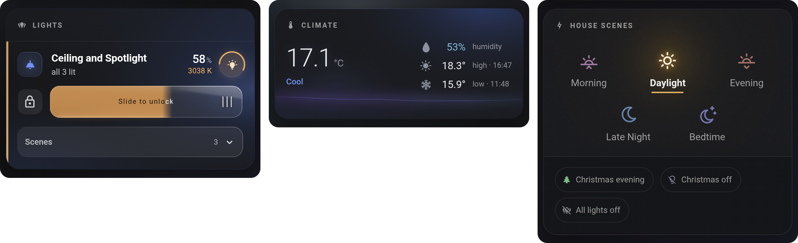
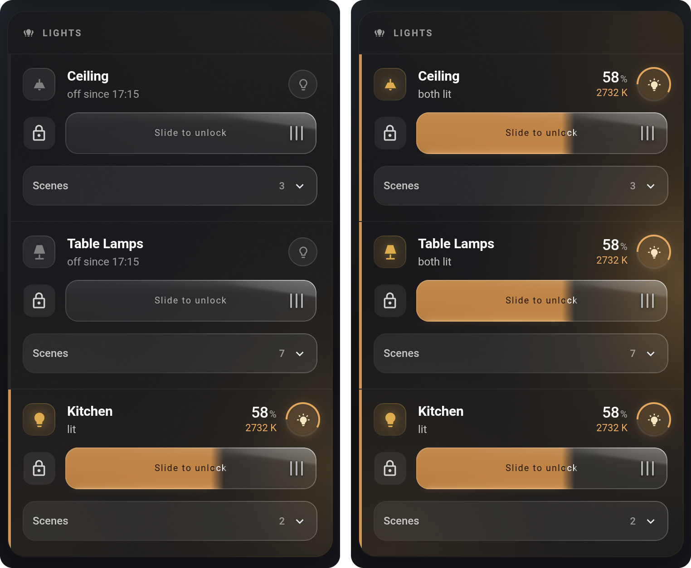

# How it works

There are a few ideas behind Lamplight. The rest of the cards make more sense once you know them.

[← Back to the README](../README.md)

## The panel

Most Lamplight cards sit on the same panel, which has a dark background, a soft rim, and light that
falls in from the right edge. There are two exceptions. The weather card has a painted sky instead,
and the house scenes have no panel light because their lamps glow on their own. What the light does
depends on the panel's [light style](#three-light-styles).

You can use the panel on its own (`custom:lamplight-panel`) and put your cards inside it. Some
cards, such as the rooms card and the waste card, already have the panel built in.

Because the panel is shared, your dashboard matches even when you mix a lot of different cards.

## Three light styles

The `light_style` key decides how the light behaves.

<p align="center">
  
</p>

| Style | What the light does | Good for |
|---|---|---|
| `activity` (the default) | Moves to the rows that are on, and gets brighter as more of them turn on. With nothing on, the panel rests in a faint glow. | Lights, rooms, anything you switch on and off |
| `accent` | Shines steadily from the top-right corner. | Panels that show information, such as climate or windows |
| `off` | No light. The panel is dark and the cards inside it glow on their own. | Cards that already have their own light, such as the house scenes |

```yaml
type: custom:lamplight-panel
accent: lagoon
light_style: accent
cards:
  - type: custom:lamplight-climate
    temperature: sensor.living_room_temperature
    humidity: sensor.living_room_humidity
```

If you would like the light to come from the top edge instead of the corner, add
`light_from: top-edge`.

## What moves the light

With `light_style: activity`, the panel watches the things in its `entities` list. List them in the
same order as the rows, from top to bottom, and the light will gather around the rows that are on:

```yaml
type: custom:lamplight-panel
accent: marigold
entities:
  - light.living_room
  - light.living_room_lamp
  - light.kitchen
cards:
  - type: custom:lamplight-light
    light: light.living_room
    accent: marigold
  - type: custom:lamplight-light
    light: light.living_room_lamp
    accent: marigold
  - type: custom:lamplight-light
    light: light.kitchen
    accent: marigold
```

If you turn on the kitchen light, the glow sits low in the panel. Turn on the top light as well and
it moves up between the two. The whole panel is lit once all three are on.

<p align="center">
  
</p>

## The accent color

Each panel has one color, called its accent. It's easiest to set it with a palette name like
`marigold` or `lagoon`. All the names are in [Styling](styling.md).

The color can also change with what's happening at home. There are two rules for this.

`first-on` takes the color of the first entity in the list that is on. `fallback` sets the color to
use when none of them are. This windows panel turns sky blue when a window opens:

```yaml
accent:
  pick: first-on
  from:
    - entity: binary_sensor.bedroom_window
      accent: window-open
    - entity: binary_sensor.kitchen_window
      accent: window-open
  fallback: denim
```

`most-recently-triggered` takes the color of whichever entity ran last. Here, a scenes panel takes
the color of the last routine you ran:

```yaml
accent:
  pick: most-recently-triggered
  from:
    - entity: script.good_morning
      accent: honey
    - entity: script.good_night
      accent: periwinkle
```

## Your other cards fit in

You can put any card in a Lamplight panel, not only Lamplight ones. A standard Home Assistant card
(an entities card or a gauge, say) takes on the Lamplight look. Its own border goes, its text turns
white, and its switches and icons use the panel's color.

```yaml
type: custom:lamplight-panel
accent: cornflower
light_style: accent
cards:
  - type: entities
    entities:
      - switch.coffee_machine
```

If you would rather have a card keep its own colors, add `restyle_children: false` to the panel.

## Popups

A popup is a sheet that slides up from the bottom of the screen with more detail. Each one has a
hash, which is a name that starts with `#`, such as `#today`. Any card can open it by going to that
hash, so you can open one popup from several places.

With `header_art: live`, the top of the popup shows a picture made from the card inside it. It might
be a lit plug, or a frost crystal for a cold room, or sunlight coming through a window. You'll see
the popup's icon until the data arrives.

See [Getting started](getting-started.md#your-first-popup) for how to make one, and
[Popups](cards/popups.md) for the details.

## Names and icons

Most cards take their name and icon from the entity, as Home Assistant's own cards do. If your
household calls something by another name, set `name:` and `icon:` yourself. The words on the screen
should be the ones your family actually says.

## Made for a phone

Lamplight was designed to be phone-first, and everything is checked on a screen 375 pixels wide. It
looks best in a single column. To keep your last card clear of the phone's bottom bar, add a spacer
at the foot of the view:

```yaml
type: custom:lamplight-spacer
```
