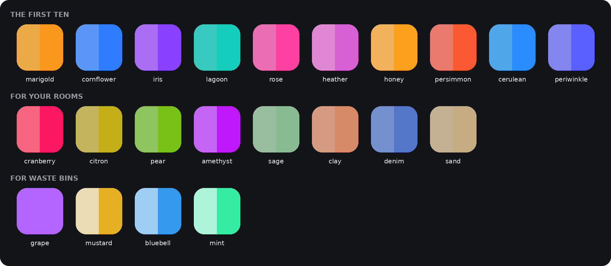

# Styling

You don't have to style Lamplight at all. If you do want to make it your own, this page has the
colors, what each one means, and the things you can change.

[← Back to the README](../README.md)

## Colors by name

Every color key in Lamplight takes a name. If you write `accent: marigold` instead of a number, the
card picks the right shade for what it's drawing.

<p align="center">
  
</p>

The first ten are the colors from the home where Lamplight was made. They are bright and lively.

| Name | Soft | Deep |
|---|---|---|
| `marigold` | 235,170,70 | 250,152,30 |
| `cornflower` | 90,150,245 | 46,124,255 |
| `iris` | 170,110,245 | 138,64,255 |
| `lagoon` | 55,200,190 | 20,205,188 |
| `rose` | 235,110,180 | 255,64,160 |
| `heather` | 222,136,212 | 214,96,210 |
| `honey` | 242,178,92 | 252,160,30 |
| `persimmon` | 232,121,107 | 250,88,48 |
| `cerulean` | 79,166,233 | 40,140,255 |
| `periwinkle` | 130,134,236 | 90,96,255 |

The next eight are for your rooms. Four of them are bright and four are quiet. A quiet color gives
the panel a gentler glow, which can be nice in a bedroom.

| Name | Soft | Deep | Kind |
|---|---|---|---|
| `cranberry` | 247,100,127 | 252,23,98 | bright red |
| `citron` | 196,181,93 | 197,175,24 | bright yellow |
| `pear` | 142,196,93 | 120,194,24 | bright lime |
| `amethyst` | 196,101,243 | 190,24,251 | bright violet |
| `sage` | 153,189,159 | 136,187,146 | quiet green |
| `clay` | 212,155,129 | 214,137,102 | quiet terracotta |
| `denim` | 116,144,206 | 83,118,201 | quiet blue |
| `sand` | 196,177,147 | 196,171,129 | quiet beige |

The last four were made for waste bins. Their chip, glow and label are tuned to read well on the
waste panel. You can use them anywhere, though they look best on [the waste card](cards/waste.md).

| Name | Color | Made for |
|---|---|---|
| `grape` | 180,100,255 | Food waste |
| `mustard` | 229,177,34 | General waste |
| `bluebell` | 52,153,237 | Paper |
| `mint` | 52,237,163 | Glass and plastics |

Apart from the four waste bin colors, all of these also come as glass orbs for the house scenes
card. See [House scenes](cards/house-scenes.md).

> [!TIP]
> Give each room its own color and use it everywhere for that room: on its light rows, its climate
> row and its popups. After a while you will know which color is which room without reading
> anything.

## Soft and deep

Each color has two tones. The soft one is for small things like an icon tile or a line in a chart,
and the deep one is for the light of a whole panel. You only need to write the name, because each
card knows which tone to use.

To use the other tone, add it after a dot:

```yaml
accent: marigold.deep
```

## Reserved styles

Some colors have a job, and Lamplight keeps them for it. Sky blue always means that a window is
open. Green always means "comfortable" or "fine". This is why none of the room colors is bright
green or sky blue. You should never mistake a room for a warning.

You can use these names anywhere that a color is asked for. Write them with a hyphen.

| Name | What it means | Color |
|---|---|---|
| `window-open` | A window is open | 60,200,235 |
| `comfort-cool`, `comfort-comfortable`, `comfort-warm` | A room is cool, comfortable or warm | 90,150,245 · 78,200,130 · 235,120,70 |
| `felt-colder`, `felt-warmer` | It feels colder or warmer outside than the thermometer says | 172,166,250 · 240,180,120 |
| `battery-alert`, `battery-notice`, `battery-hand`, `battery-full` | Replace soon, worth noticing, fine, full | 235,120,70 · 232,195,74 · 78,200,130 · 78,200,130 |
| `filter-alert`, `filter-notice`, `filter-hand` | An air filter needs changing soon, is worth noticing, is fine | 235,120,70 · 232,195,74 · 78,200,130 |
| `attention-mark` | A count on the rooms card that needs a look | 235,120,70 |
| `plug-light` | The glow of a smart plug that is on | 250,152,30 |
| `panel-rest` | A panel with nothing to say, for example the waste panel with no bin due | 143,160,189 |
| `page-ink` | Quiet text on the dashboard background, outside a panel | 143,160,189 |
| `weather-notice`, `weather-moderate`, `weather-severe`, `weather-extreme` | Weather warning levels | see below |

On a few cards you can change a meaning for that card only, such as the comfort colors on a climate
card. Those keys are listed on each card's page.

## Weather warning colors

Warning colors follow the international severity scale for weather alerts: moderate, severe,
extreme. The card still shows the word your weather service uses. For the UK Met Office, yellow is
moderate, amber is severe and red is extreme.

## Other ways to write a color

A name is the easiest, but a color can also be written as numbers:

```yaml
accent: "250,152,30"     # red, green, blue
accent: "#fa981e"        # hex
accent: "rgb(250,152,30)"
```

Note that CSS color names such as `orange` or `teal` won't work, because it's too easy to confuse
them with the palette names. If you do use one, the card tells you and lists the palette names
instead.

## Changing the look

You can change the background, the corner radius, the shadow, and the size and brightness of the
text. The settings for these are called tokens.

| Token | Default | What it changes |
|---|---|---|
| `ground` | `rgb(19,20,24)` | The panel background |
| `radius` | `20px` | The corner radius |
| `shadow` | `0 6px 22px rgba(0,0,0,0.35)` | The shadow under each panel |
| `t-label` | `10px` | Small capital labels |
| `t-caption` | `11px` | Units and small notes |
| `t-state` | `12px` | State lines and pills |
| `t-body` | `14px` | Sentences |
| `t-name` | `15px` | Row names |
| `t-inline` | `17px` | A number in a row |
| `t-room` | `18px` | A room name |
| `t-title` | `24px` | A popup title |
| `t-display` | `36px` | A large number |
| `t-reading` | `56px` | The big reading on a climate popup |
| `ink-quiet`, `ink-soft`, `ink-mid`, `ink-strong` | white at 50%, 56%, 72%, 92% | The four text brightnesses |

You can set a token in two places.

To change one card, and every card inside it, use the `theme` key:

```yaml
type: custom:lamplight-panel
accent: lagoon
theme:
  ground: '#101418'
  radius: 16px
  t-body: 15px
cards: []
```

To change the whole dashboard, use a Home Assistant theme and add `lamplight-` in front of each
name:

```yaml
my_theme:
  lamplight-ground: '#101418'
  lamplight-radius: 16px
```

If the same token is set in both, the card's `theme` key wins. If you misspell a token, the card
shows an error with the list of names.

## What you can't change

The light itself is fixed, meaning how bright it gets, where it sits and how it fades. Those numbers
only work as a set, and they keep the text readable on every color. If you want a different feel,
try another color or [light style](how-it-works.md#three-light-styles).

## Smooth gradients

Some screens show faint bands in a dark gradient, so Lamplight lays a very fine grain over the light
to hide them. You can turn it off on any panel:

```yaml
smooth_gradient: false
```
